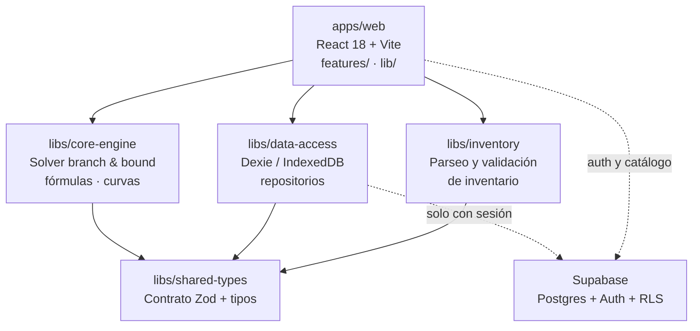
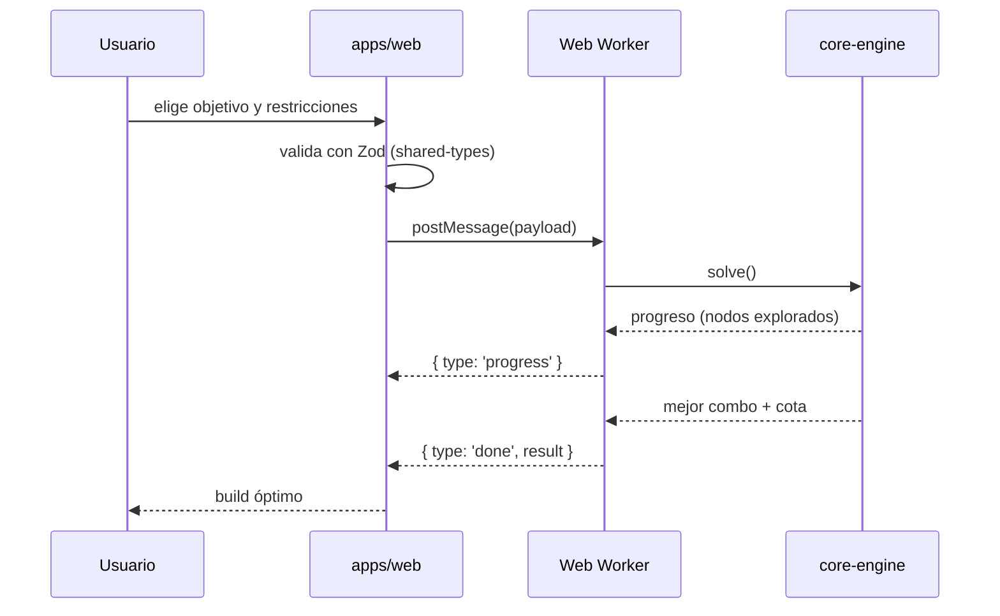
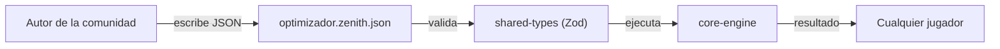
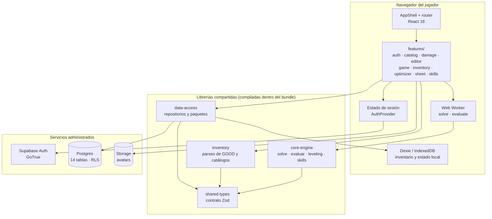
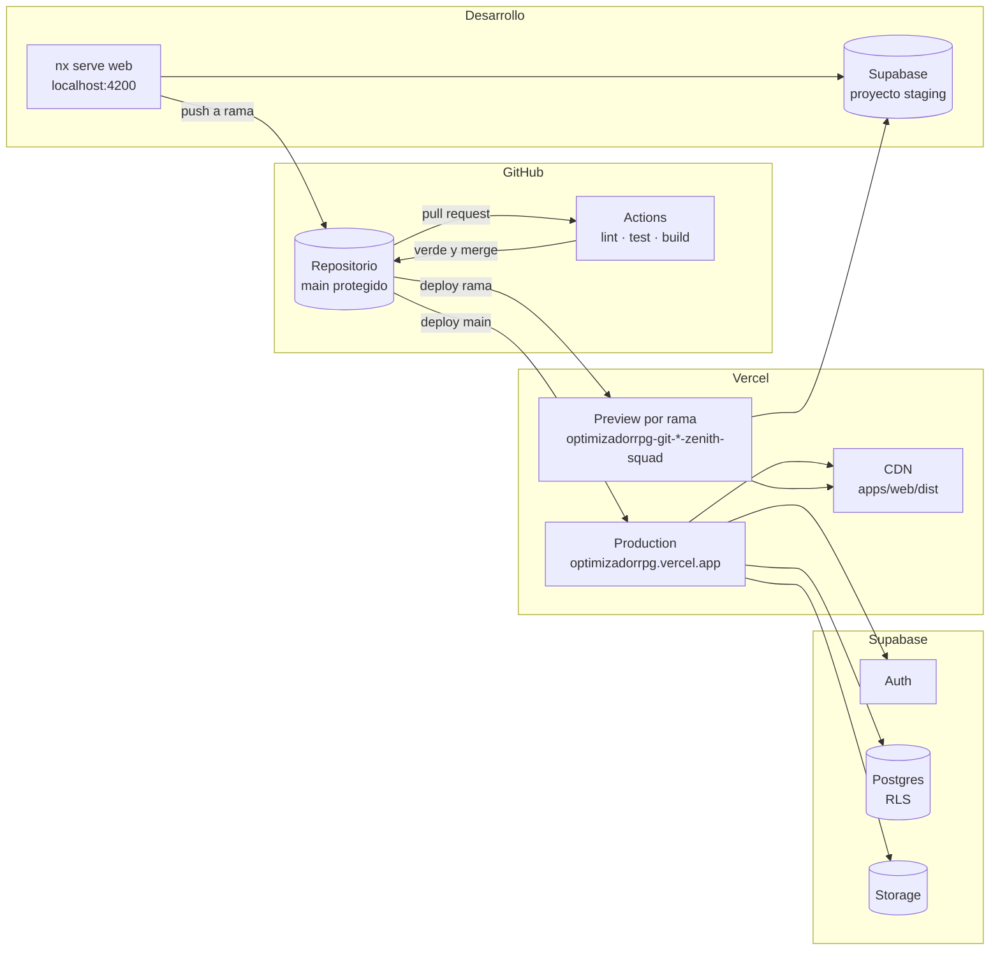

# Arquitectura

Zenith Optimizer es una aplicación client-side. El cálculo se ejecuta en el navegador y el servidor
nunca resuelve una optimización. El resto de las decisiones arquitectónicas se derivan de esa
premisa.

## Principio rector

> **El servidor almacena y distribuye; nunca calcula.**

El solver explora combinaciones de inventario y habilidades. El espacio de búsqueda crece de forma
exponencial con la cantidad de piezas. Ejecutarlo en el cliente produce tres consecuencias que
definen el producto:

1. **Costo marginal cero por usuario.** No existe cómputo que escalar ni cola de trabajos.
2. **El inventario no sale del dispositivo.** La privacidad es una propiedad del diseño, no una
   promesa.
3. **Operación sin conexión.** El motor no depende de una API para entregar un resultado.

## Capas

| Capa | Responsabilidad | Restricción |
|---|---|---|
| `apps/web` | interfaz, rutas y estado de sesión | no calcula estadísticas |
| `libs/core-engine` | resuelve la mejor combinación | no accede al DOM ni al almacenamiento |
| `libs/data-access` | persiste y lee datos del navegador | no contiene reglas de negocio |
| `libs/inventory` | interpreta formatos de inventario | no depende de un juego concreto |
| `libs/shared-types` | define el contrato | no contiene lógica |
| Supabase | almacena y distribuye | no calcula |

`core-engine` es TypeScript puro: no depende de React, del DOM ni del almacenamiento. Esta
independencia permite ejecutar 197 casos unitarios sin montar un navegador.

## Flujo de una optimización

El Web Worker existe por una razón concreta: la búsqueda puede tardar segundos y bloquearía el hilo
de la interfaz. Al trasladarla a un Worker, el progreso se dibuja mientras el motor trabaja.

Existe un único Worker, `optimizer.worker.ts`, que admite dos tipos de mensaje:

- `solve`: ejecuta una búsqueda completa y reporta progreso.
- `evaluate`: evalúa un equipo ya equipado sin ejecutar búsqueda. Lo usa la hoja de personaje para
  mostrar la build actual del jugador.

## Por qué el resultado es exacto

El motor no aproxima. Aplica branch and bound con dos cotas superiores:

- En cada nodo se acota el mejor valor alcanzable antes de explorar sus hijos.
- Si la cota no supera al mejor valor encontrado, la rama se poda y no se expande.

Las cotas son válidas por construcción y nunca subestiman. Por esta razón, si la búsqueda termina,
el óptimo queda demostrado. El resultado declara esa garantía en `provenOptimal` e incluye el
número de nodos podados. Esto permite auditar la garantía en lugar de confiar en una afirmación del
README.

No existe un segundo algoritmo heurístico. Es la misma búsqueda con un presupuesto de tiempo
opcional:

- **Sin límite** (`Infinity`): recorre el espacio completo.
- **Con límite**: al agotarse, se detiene y devuelve el mejor resultado encontrado, con
  `provenOptimal: false` y `stoppedBy: 'tiempo'`.

El resultado siempre declara qué garantía posee. En consecuencia, una build no probada no se
confunde con una óptima.

## El contrato como producto

Un optimizador es un JSON que describe un juego: estadísticas, slots, restricciones y variables
derivadas. No existe código específico por juego.

La consecuencia es directa: agregar un juego no requiere modificar el motor ni el backend. Solo
requiere un archivo que cumpla el contrato.

## Datos

- **Datos del jugador:** IndexedDB mediante Dexie (`libs/data-access`). Almacena el inventario, el
  equipo, las habilidades, el historial de niveles y las estadísticas base por juego. Es local por
  defecto.
- **Cuentas, catálogo comunitario, votos y favoritos:** Supabase. De carácter opcional: sin
  `VITE_SUPABASE_URL`, la aplicación funciona con fixtures locales.
- **Regla de exposición:** la `anon key` se envía al navegador por diseño. Lo que protege los datos
  son las políticas RLS de Postgres, no el secreto de la clave.

El modelo relacional completo, con sus relaciones y la justificación de su normalización, se
documenta en [`modelo-de-datos.md`](./modelo-de-datos.md).

## Componentes

La siguiente tabla distingue qué se ejecuta en el navegador y qué reside en el servidor.

| Componente | Tipo | Responsabilidad |
|---|---|---|
| `AppShell` + router | cliente | navegación y layout |
| `features/*` | cliente | una carpeta por dominio funcional |
| Worker del solver | cliente | cálculo pesado fuera del hilo de la interfaz |
| `core-engine` | librería | resuelve; no conoce React ni el DOM |
| `data-access` | librería | persistencia y empaquetado |
| `inventory` | librería | interpreta formatos de terceros |
| `shared-types` | librería | contrato validado con Zod |
| Supabase Auth | servicio | registro, sesión y confirmación por correo |
| Postgres | servicio | datos compartidos, protegidos por RLS |
| Storage | servicio | avatares de perfil |

## Despliegue

La aplicación consta de tres entornos y un artefacto estático. No existe un servidor de aplicación
propio: el cálculo no lo requiere y la API la proporciona Supabase.

| Entorno | Ubicación | Base de datos | Variables |
|---|---|---|---|
| Desarrollo | `localhost:4200` | local (mocks o Supabase CLI) | `.env.local` con prefijo `VITE_` |
| Preview | Vercel, una por rama | staging | scope **Preview** |
| Producción | `optimizadorrpg.vercel.app` | producción | scope **Production** |

**Justificación del aislamiento de producción.** Las variables `VITE_*` se incorporan al bundle
durante el build, y cada entorno posee su propio scope. En consecuencia, un preview de una rama
escribe en staging y la verificación no altera los datos reales. El aislamiento no depende de que
alguien recuerde seleccionar el entorno correcto: depende de qué variables recibió el build.

La matriz completa de ambientes se documenta en `docs/entornos.md` y el procedimiento en
`README.md`.
