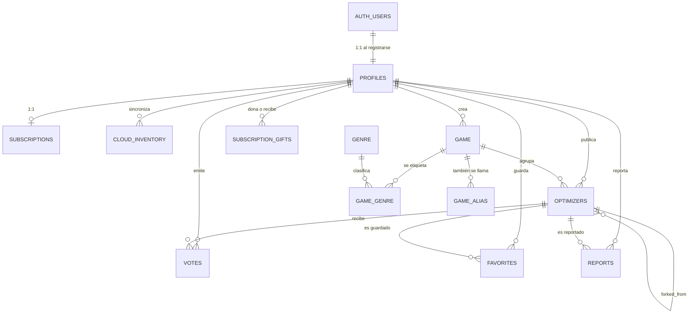

# Modelo de datos

Zenith Optimizer almacena los datos en dos sistemas de almacenamiento. Esta separación responde a
una decisión arquitectónica, no a un detalle de implementación.

| Almacenamiento | Qué almacena | Criterio de elección |
|---|---|---|
| **IndexedDB** (Dexie, en el dispositivo) | inventario, equipo, habilidades e historial de niveles | el inventario puede contener miles de piezas y no requiere salir del dispositivo |
| **PostgreSQL sobre Supabase** (compartido) | perfiles, optimizadores publicados, votos, favoritos, reportes y copia en la nube | estos datos deben existir entre usuarios y persistir al cambiar de dispositivo |

El motor de cálculo no interviene en este documento. No accede a ninguno de los dos sistemas de
almacenamiento. Recibe un contrato validado y devuelve un resultado.

## Las tablas y sus relaciones

El esquema comprende 14 tablas de dominio, además de `auth.users`, administrada por Supabase.

El diagrama contiene diecisiete relaciones.

**Notación.** Cada relación declara su cardinalidad:

- `||--||`: uno a uno obligatorio. Un usuario posee exactamente un perfil.
- `||--o{`: uno a muchos. Un juego agrupa varios optimizadores.
- `o|`: participación opcional. Un perfil puede tener suscripción o carecer de ella.

## Los cuatro grupos de tablas

Las 14 tablas se organizan por propósito. Esta agrupación es la forma prevista de lectura.

### Catálogo de juegos

Este grupo define el vocabulario del producto. Un juego se registra una vez y todos los
optimizadores lo referencian mediante una foreign key.

| Tabla | Propósito |
|---|---|
| `game` | almacena un juego con nombre canónico, slug y portada |
| `genre` | almacena una etiqueta de género, por ejemplo Action RPG o Gacha |
| `game_genre` | resuelve la relación muchos a muchos entre juego y género |
| `game_alias` | almacena un nombre alternativo del juego para permitir búsquedas |

El catálogo existe para que el nombre del juego tenga una sola fuente. La foreign key
`optimizers.game_id` es obligatoria, de modo que un optimizador no puede declarar un juego
distinto al que referencia.

Por ejemplo, cuando un usuario busca "genshin", `game_alias` resuelve el alias a un único `game`.
Desde ese registro se listan todos los optimizadores del juego. Sin alias, la misma búsqueda
devolvería resultados distintos según la forma en que cada autor escribió el nombre.

### Optimizadores y comunidad

| Tabla | Propósito |
|---|---|
| `optimizers` | almacena una build publicada con su plantilla, objetos de muestra, autor y estado |
| `votes` | registra un voto de -1 o 1 por usuario y optimizador |
| `favorites` | registra un optimizador guardado por un usuario |
| `reports` | registra un reporte de contenido inapropiado |

`optimizers` almacena la plantilla del juego como JSONB. Ese documento constituye el contrato que
consume el motor. Las columnas sometidas a consulta y ordenamiento (`score`, `votes_count`,
`cover`, `name`) son columnas reales.

### Cuentas y suscripciones

| Tabla | Propósito |
|---|---|
| `profiles` | almacena nombre visible, avatar, biografía y rol |
| `subscriptions` | almacena el plan del usuario y su fecha de corte |
| `app_settings` | almacena la configuración global en una sola fila |
| `subscription_gifts` | registra un mes regalado de un usuario a un creador |
| `stripe_events` | registra un evento recibido desde el webhook de Stripe |

`subscription_gifts` y `stripe_events` admiten escritura exclusivamente del servidor. El cliente
no posee permiso de escritura sobre ninguna de las dos.

**Justificación de `subscription_gifts` como tabla.** `subscriptions` almacena estado: una fila por
usuario, con su plan y su fecha de corte. Una donación es un hecho con fecha, origen y destino.
Dos donaciones al mismo creador producen dos filas, y el estado del receptor no puede
representarlas. Por esta razón el historial se almacena en una tabla independiente.

**Justificación de `stripe_events` como tabla.** Stripe reintenta un evento cuando no recibe una
respuesta 2xx. Sin un registro, el reintento acreditaría los meses dos veces. `stripe_events.event_id`
es la natural key que Stripe mantiene estable entre reintentos. Un evento repetido colisiona con la
primary key y no se procesa de nuevo.

### Inventario en la nube

`cloud_inventory` constituye el único miembro de este grupo. Almacena una copia del inventario por
usuario y por juego.

Su primary key es compuesta: `(user_id, game_key)`. Un usuario mantiene un paquete y un estado por
juego, no uno global. Esto permite distinguir el almacenamiento de un inventario del de varios
juegos.

La columna `client_updated_at` registra el instante del último cambio en el dispositivo. Esto
permite resolver conflictos cuando el mismo juego se edita desde dos equipos.

## Decisiones que se reflejan en el diagrama

**`profiles` depende de `auth.users`.** Supabase administra la autenticación; el perfil es un dato
de la aplicación. La sincronización entre ambas tablas se sostiene con dos mecanismos:

- `cascade delete`: al eliminar la cuenta se elimina el perfil y todo registro dependiente.
- El trigger `on_auth_user_created`: crea el perfil y la suscripción en el instante del registro.

En consecuencia, no es posible registrar un usuario sin perfil asociado.

**Las composite keys evitan duplicados de negocio.** `votes (user_id, optimizer_id)` impide votar
dos veces el mismo optimizador. `favorites (user_id, optimizer_id)` aplica la misma regla a los
favoritos. La validación reside en la base de datos y no en el cliente, donde puede eludirse.

**`optimizers.forked_from` es una self-reference.** Crear una variante de un optimizador ajeno no
copia el original: lo referencia. Esto permite reconstruir el linaje y determinar qué se modificó.
La columna admite `null` porque un optimizador original carece de predecesor.

**`reports` admite reportes sucesivos.** El índice único
`reports_active_unique (reporter_id, optimizer_id) where status <> 'dismissed'` se aplica solo a
los reportes vigentes. Un reporte descartado no bloquea uno nuevo, de modo que el mismo problema
puede reportarse otra vez.

## Normalización

El esquema se encuentra en tercera forma normal, con dos excepciones deliberadas.

### Las tres formas

- **1FN, valores atómicos.** Cada columna almacena un valor y no una lista. Los campos `text`
  declaran restricciones de longitud mediante `char_length` en la base de datos.
- **2FN, ausencia de dependencias parciales.** Ninguna tabla con composite key posee atributos que
  dependan de una sola parte de la clave. En `votes`, el valor depende de la pareja completa.
- **3FN, ausencia de dependencias transitivas.** Ningún atributo no clave depende de otro atributo
  no clave. El nombre del autor no se replica en `optimizers`: se obtiene mediante `author_id`.

### Excepción 1: columnas JSONB

`optimizers.template`, `optimizers.sample_items`, `cloud_inventory.template`,
`cloud_inventory.items` y `cloud_inventory.state` almacenan documentos completos.

Normalizarlos exigiría una tabla por cada concepto del juego: atributos, ranuras, conjuntos,
variables derivadas y objetivos. Además obligaría a reconstruir el documento en cada lectura para
alimentar al motor.

El costo se acota con tres medidas:

- Validación con Zod (`GameTemplateSchema`) previa a la escritura.
- Límite de tamaño en la base de datos (`octet_length <= 5 MB`).
- Extracción a columnas reales de todo dato sometido a consulta: autor, nombre, estado y puntaje.

Por ejemplo, el motor recibe `template` en el formato almacenado y no ejecuta una consulta por
cada atributo del juego.

### Excepción 2: dos contadores desnormalizados

| Columna | Depende de | Justificación |
|---|---|---|
| `optimizers.score` | `votes.value` | el catálogo ordena y pagina por esta columna en cada consulta |
| `optimizers.votes_count` | cantidad de filas en `votes` | se presenta en cada tarjeta del catálogo |

Sin estas columnas, cada listado del catálogo requeriría un `join` con agregación sobre `votes`.

Ambos valores se mantienen consistentes mediante el trigger `refresh_optimizer_score`, que los
recalcula en cada `insert`, `update` o `delete` sobre `votes`. El índice
`optimizers_ranking_idx (published, score desc, created_at desc)` sirve exactamente a esa consulta.
Ningún cliente escribe estas columnas.

## Reglas de integridad

Las restricciones se declaran en la base de datos.

| Regla | Mecanismo |
|---|---|
| un voto por usuario y optimizador | composite key |
| valor del voto en -1 o 1 | `check (value in (-1, 1))` |
| un reporte vigente por usuario y optimizador | índice único parcial sobre los no descartados |
| roles válidos | `check (role in ('user', 'admin'))` |
| longitud de los textos del perfil | `check (char_length(...) between ...)` |
| tamaño de la plantilla | `check (octet_length(template::text) <= 5000000)` |
| `updated_at` actualizado | trigger `set_updated_at` en cada tabla |
| prohibición de autodonación | `check (from_user_id is distinct from to_user_id)` |

## Seguridad

Row Level Security (RLS) es un mecanismo de seguridad de PostgreSQL que opera a nivel de fila. Las
políticas RLS definen qué filas específicas puede leer o escribir cada usuario.

Las 14 tablas tienen RLS activada, con 40 políticas en total. Cada tabla concede únicamente los
privilegios necesarios, y por columna cuando corresponde. Un usuario puede actualizar
`display_name`, `avatar_url` y `bio`. No puede modificar su `role`.

| Tabla | Lectura | Escritura |
|---|---|---|
| `profiles` | pública | solo el propio, sin acceso a `role` |
| `optimizers` | publicados o propios | solo el autor |
| `votes` | pública | solo el emisor |
| `favorites` | solo el dueño | solo el dueño |
| `reports` | solo el emisor | solo el emisor |
| `cloud_inventory` | solo el dueño | solo el dueño, con suscripción activa |
| `subscriptions` | solo el dueño | ninguna desde el cliente |
| `app_settings` | pública | ninguna desde el cliente |
| `game`, `genre`, `game_genre`, `game_alias` | pública | solo administradores |
| `subscription_gifts` | el donante y el receptor | ninguna desde el cliente |
| `stripe_events` | ninguna | ninguna desde el cliente |

La escritura del catálogo queda restringida a administradores. El vocabulario es compartido y no
debe quedar a merced de cualquier usuario.

### Dos capas de permisos

El sistema de seguridad opera en dos capas complementarias:

- **Privilegios de tabla.** Determinan qué operaciones (SELECT, INSERT, UPDATE, DELETE) puede
  realizar un usuario sobre una tabla completa.
- **Row Level Security (RLS).** Filtra las filas específicas que cada usuario puede leer o escribir
  dentro de una tabla.

Ambos mecanismos se complementan. Los privilegios de tabla actúan como primera capa de control. Las
políticas RLS afinan el acceso a nivel de fila.

Una migración reciente revocó los privilegios por defecto para los roles `anon` y `authenticated`.
Esto significa que cualquier objeto nuevo (tabla, vista o función) no tendrá permisos de escritura
por defecto para estos roles. La medida resuelve un problema concreto. Antes de esa migración, todo objeto creado nacía con INSERT, UPDATE, DELETE y TRUNCATE concedidos.

La corrección se aplicó en dos frentes:

- **Privilegios por defecto revocados.** Protegen los objetos que se creen desde ahora, de modo que
  nada resulte accesible sin permisos explícitos.
- **Revocaciones explícitas.** Protegen los objetos existentes, que ya se habían creado con los
  permisos por defecto.

### Verificación

La seguridad se verifica y no se declara. `npx nx test supabase` ejecuta 96 casos contra PGlite.

Cada caso crea usuarios con roles distintos y a continuación intenta leer y escribir lo que no les
corresponde. Una política mal escrita interrumpe la prueba.

## Aplicación del esquema

El esquema no se edita en el panel de Supabase. Se almacena en `supabase/migrations/` y se aplica
con `supabase db push`.

Cada cambio requiere una migración nueva. Las anteriores no se editan, porque ya se aplicaron en
algún entorno.

Los tipos de TypeScript se generan desde la base de datos
(`libs/shared-types/src/lib/database.types.ts`). En consecuencia, un cambio de columna rompe la
compilación en lugar de fallar en producción.

## La vista `optimizer_cards`

El catálogo no consulta `optimizers` directamente. Lee la vista `optimizer_cards`.

La vista resuelve en una sola consulta los datos que la interfaz requiere por tarjeta:

- el nombre y la portada del optimizador
- el nombre del juego, obtenido desde `game`
- el arreglo de géneros, resuelto mediante un subselect
- el autor con su nombre y avatar
- el puntaje y la cantidad de votos

Expone únicamente los optimizadores con `published = true`.

Por ejemplo, cuando el catálogo presenta 24 tarjetas, la vista entrega esas 24 filas completas. La
interfaz no ejecuta consultas adicionales para dibujarlas.

Los géneros se resuelven con `coalesce(..., '{}')`. Un juego sin géneros asignados devuelve un
arreglo vacío en lugar de `NULL`. El cliente no necesita distinguir ambos casos.

## Ubicación de los recursos

| Recurso | Ubicación |
|---|---|
| esquema aplicado, en orden | `supabase/migrations/` |
| procedimiento de migración | `supabase/README.md` |
| definición de los tres ambientes | `docs/entornos.md` |
| tipos consumidos por la aplicación | `libs/shared-types/src/lib/database.types.ts` |
| pruebas de seguridad | `supabase/tests/rls.spec.ts` |
