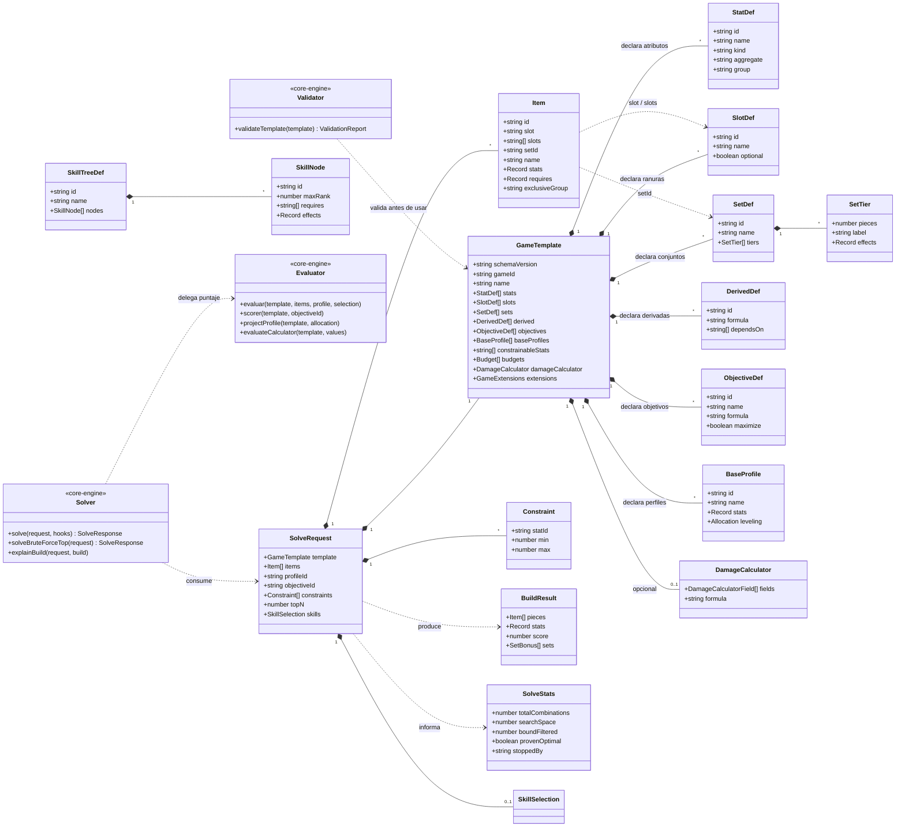
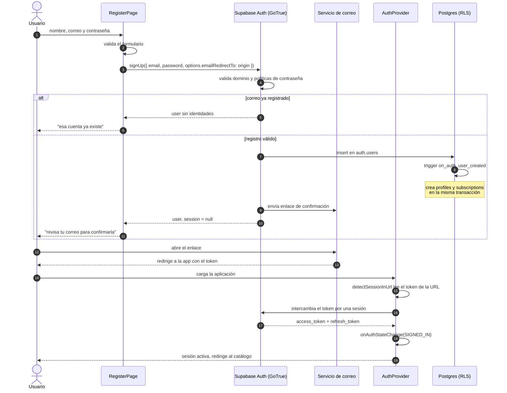
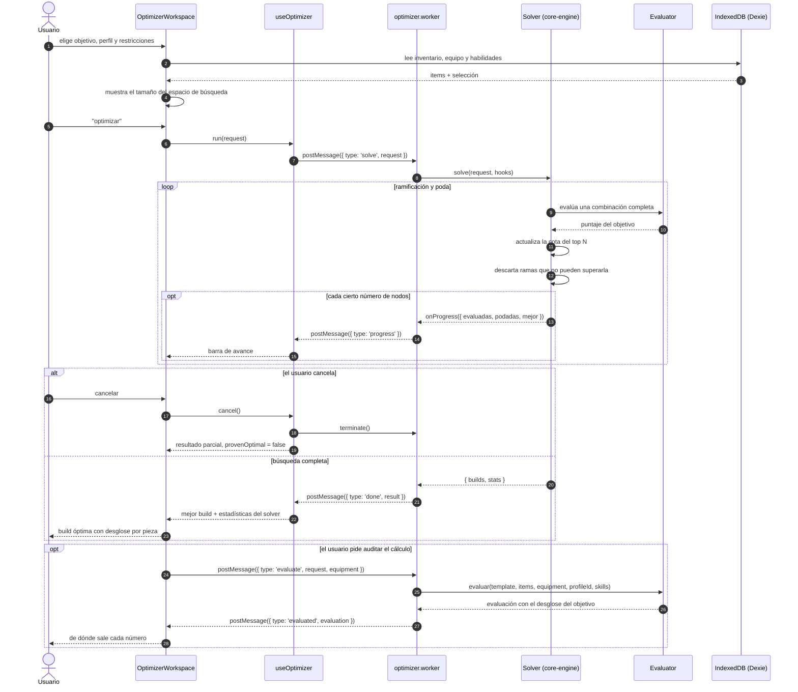

# Diagramas UML

Este documento presenta dos vistas del sistema. La primera es el contrato que permite que el motor sirva para cualquier juego. La segunda corresponde a las dos funcionalidades principales en el tiempo. Se trata del alta de usuario y del cálculo de la mejor build.

Los diagramas se escriben en Mermaid. De esta forma se versionan junto al código y se actualizan
mediante un pull request. Ninguno se dibuja a mano en una herramienta externa, donde quedaría
desactualizado en la siguiente iteración.

## Diagrama de clases: el contrato del juego

`GameTemplate` es el único dato específico de un juego. El motor no conoce Genshin, WoW ni Elden
Ring: conoce esta estructura. El resto de los elementos (interfaz, listado de atributos, orden de
cálculo y objetivos) se deriva de ella.

**Justificación del diseño.** `Item` no conoce `GameTemplate`: solo declara ranura, conjunto y
estadísticas por clave. Esta indirección permite que el mismo binario del motor resuelva siete plantillas de cinco juegos distintos. No requiere una línea de código condicional por juego. Cuando una
pieza requiere un atributo propio del género, se declara en `extensions`, que el núcleo no
interpreta.

`SolveRequest` es serializable. Viaja por `postMessage` a un Web Worker sin transformación, de modo
que el motor nunca bloquea la interfaz.

## Secuencia 1: registro de usuario con confirmación por correo

**Qué demuestra este diagrama.** El perfil no lo crea el cliente. Lo crea un trigger cuando nace el
usuario en `auth.users`. Por esta razón no existe una ventana en la que haya una cuenta sin perfil.
El `redirect_to` que viaja en el registro corresponde al origen real desde donde se registró
(producción, preview o local). Esto permite que el enlace funcione en los tres entornos.

**Modo de falla conocido.** Está documentado en `supabase/README.md`. El SMTP integrado de Supabase
limita los envíos por hora y devuelve `429 over_email_send_rate_limit`. Con la confirmación
activada, el usuario no puede ingresar hasta que el correo llegue. Para una demostración se requiere
un SMTP propio.

## Secuencia 2: cálculo de la mejor build

**Qué demuestra este diagrama.** El cálculo ocurre en el navegador, dentro de un Web Worker, y la
interfaz nunca se bloquea. El motor informa progreso y cota, de modo que el usuario observa la
exploración y el podado en tiempo real. Un resultado no se declara óptimo por confianza.
`provenOptimal` indica que la búsqueda agotó el espacio. Cuando el usuario cancela, el resultado
parcial se marca como tal y no se presenta como óptimo.

La evaluación y la auditoría del cálculo utilizan el mismo Worker, mediante el mensaje `evaluate`.
No existe un segundo Worker. El Worker atiende un mensaje a la vez. El modo `evaluate` no ejecuta
búsqueda: solo puntúa un equipo ya equipado. Esto permite auditar un número sin lanzar una nueva
optimización.
