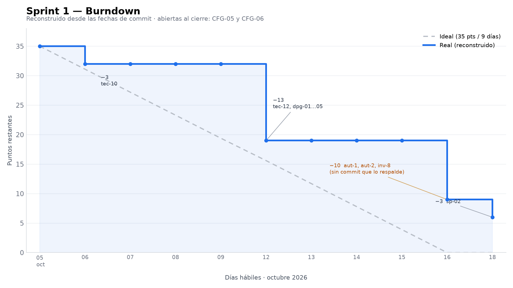

# Sprint 1 — Burndown



> **Gráfico reconstruido.** El sprint permaneció en estado `future` en Jira durante todo el trabajo
> y se cerró recién el 20 de noviembre de 2026, al ordenar el proyecto. Jira no conserva el
> historial de puntos por día con esa secuencia, por lo que la curva se reconstruye a partir de las
> fechas de commit y del estado final de cada historia. Se declara de forma explícita para no
> presentar como medición lo que constituye una estimación.

## Método de reconstrucción

1. Se toma la fecha del commit que evidencia cada historia.
2. Cada día se descuentan los puntos de las historias cuyo primer commit aparece ese día o antes.
3. La línea ideal reparte 35 puntos entre los **10 días hábiles** del sprint, del 5 al 16 de
   octubre.

## Tabla

| Día | Ideal restante | Real restante | HUs que cierran |
|---|---|---|---|
| 05 oct | 35,0 | 35 | — |
| 06 oct | 31,1 | **32** | TEC-10 (−3) |
| 07 oct | 27,2 | 32 | — |
| 08 oct | 23,3 | 32 | — |
| 09 oct | 19,4 | 32 | — |
| 12 oct | 15,6 | **19** | TEC-12, DPG-01 a DPG-05 (−13) |
| 13 oct | 11,7 | 19 | Supabase y Vercel, sin cierre de HU |
| 14 oct | 7,8 | 19 | — |
| 15 oct | 3,9 | 19 | — |
| 16 oct | 0,0 | **9** | AUT-1, AUT-2, INV-8 (−10), **sin commit que lo respalde** |
| 18 oct | 0,0 | **6** | SP-02 (−3) |

## Aritmética del cierre

```
Comprometido          35 pts
Cerrado en el sprint  29 pts  (TEC-10, TEC-12, DPG-01…05, AUT-1, AUT-2, INV-8, SP-02)
Abierto al cierre      6 pts  (CFG-05, CFG-06)
Cumplimiento          29 / 35 = 83 %
```

## Lectura

- **La curva es escalonada y no diagonal.** Existen cinco días sin cierre y dos caídas netas, el 12
  y el 16 de octubre. Es el patrón de un trabajo concentrado en sesiones y no de una dedicación
  diaria uniforme.
- **Termina 6 puntos por encima de la línea ideal**, que corresponden exactamente a las dos
  historias arrastradas al Sprint 4. No existe desvío sin explicación: todo punto abierto tiene
  destino.
- **La brecha máxima no se produce al final.** Alcanzó unos 16 puntos el 9 de octubre, cuando la
  línea ideal había bajado a 19,4 y el valor real seguía en 32. Al cierre, la brecha es de 6.

## Límite del dato

La caída de 10 puntos del 16 de octubre (AUT-1, AUT-2 e INV-8) no tiene commit que la respalde. El
historial salta del 13 al 19 de octubre, y las rutas que hoy implementan esas historias
(`apps/web/src/features/auth/RegisterPage.tsx` y `libs/data-access/`) se crearon en noviembre,
durante el Sprint 3. Jira las considera cerradas dentro del Sprint 1, y esa es la única fuente de
la fecha. El repositorio no permite datarlas en ese momento.

Se dibujan el 16 de octubre porque es el último día hábil del sprint, y no porque exista evidencia
de ese día. Corresponde al mismo desfase que afecta a siete historias cerradas del Sprint 2,
documentado en [`../sprint-2/backlog.md`](../sprint-2/backlog.md). El estado en Jira y la fecha del
código no coinciden, y el documento lo declara en lugar de ocultarlo.

Jira registra SP-02 como `Done`, pero no conserva la fecha de la transición. Por esta razón, el
paso de 9 a 6 puntos tampoco puede ubicarse en un día concreto. Se dibuja en el cierre porque es lo
único verificable.

## Datos que respaldan la curva

```
2026-10-06  chore/bootstrap monorepo (#1)
2026-10-06  feat(demo): prototipo v2 con niveles, habilidades y Supabase (#2)
2026-10-12  feat(core-engine): motor portado desde el prototipo con pruebas
2026-10-12  feat(shared-types): contrato de juego completo con Zod
2026-10-13  sql_supabase, vercel.json, evidencia Fase 2
2026-10-19  siguiente commit del repositorio
```
