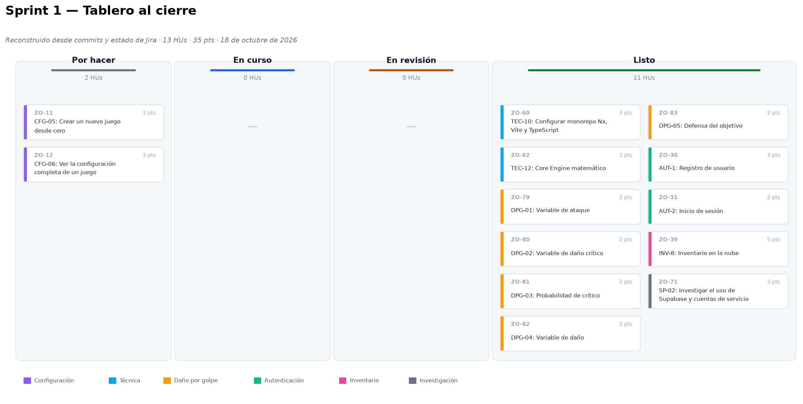

# Sprint 1 — Scrumboard



> **Render y no captura.** El gráfico se genera a partir de los datos de la API de Jira
> (`sprint = 5`, "Sprint 1 — Prototipo y motor"). Las historias, los estados y los puntos
> coinciden con lo que devuelve la consulta. El render existe para que la imagen quede versionada y
> no dependa de una sesión autenticada.
>
> Verificado el 20 de noviembre de 2026: 13 historias, 35 puntos, 11 en Listo y 2 en Por hacer.
>
> Las dos historias abiertas (CFG-05 y CFG-06) se arrastraron al Sprint 4 al cerrar el sprint, de
> modo que hoy Jira muestra 11 historias en el sprint 5. La imagen conserva las 13 comprometidas,
> que es lo que documenta un tablero al cierre.

## Columnas

| Columna | HUs |
|---|---|
| **Por hacer** | ZO-11 (CFG-05), ZO-12 (CFG-06) |
| **En curso** | — |
| **En revisión** | — |
| **Listo** | ZO-30, ZO-31, ZO-39, ZO-60, ZO-62, ZO-71, ZO-79, ZO-80, ZO-81, ZO-82, ZO-83 |

## Flujo de trabajo

```
Por hacer  →  En curso  →  En revisión  →  Listo
```

La columna **En revisión** agrupa los pull requests abiertos con CI en verde y sin merge. En este
sprint no se utilizó: los dos pull requests ingresaron de forma directa porque no existían otros
revisores además del autor.

## Distribución por épica

| Épica | HUs listas | HUs abiertas |
|---|---|---|
| Técnica (TEC) | 2 | — |
| Daño por golpe (DPG) | 5 | — |
| Autenticación (AUT) | 2 | — |
| Inventario (INV) | 1 | — |
| Investigación (SP) | 1 | — |
| Configuración (CFG) | — | 2 |

## Observación

Once de trece historias cerraron, y todas las épicas con alcance técnico quedaron completas. Lo que
permanece abierto pertenece al producto, específicamente al editor de configuración, y no al motor
ni a las decisiones técnicas. Esto explica que el sprint cumpliera su objetivo declarado aun sin
cerrar el 100 % del alcance.
