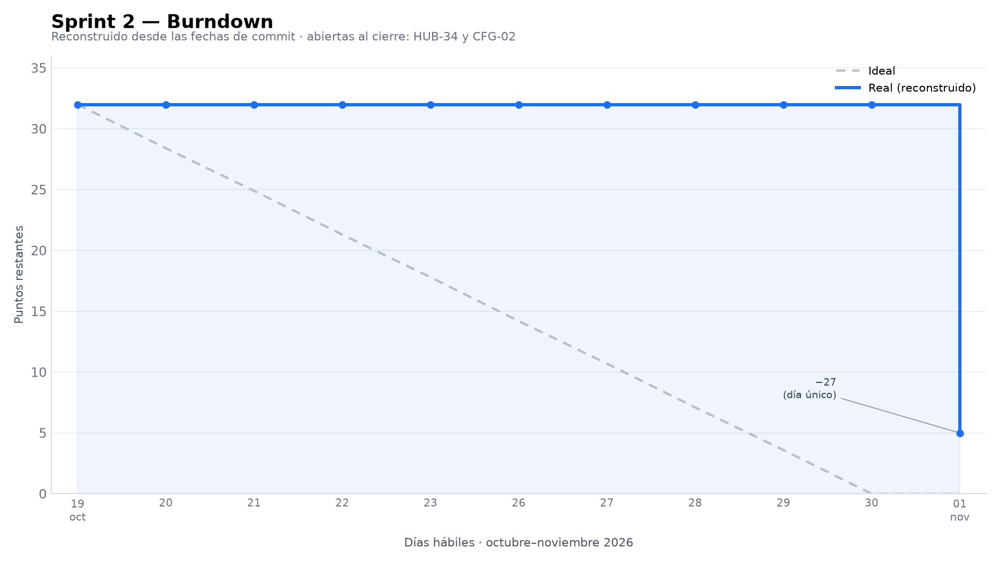

# Sprint 2 — Burndown



> **Gráfico reconstruido.** Jira conserva el estado final de cada historia y no el histórico de
> puntos por día. La curva se reconstruye desde las fechas de commit, y se declara para no
> presentar como medición lo que constituye una estimación.

## Método de reconstrucción

1. Se toma la fecha del commit que evidencia cada historia.
2. Cada día se descuentan los puntos de las historias cuya evidencia aparece ese día o antes.
3. La línea ideal reparte 32 puntos entre los **10 días hábiles** del sprint, del 19 al 30 de
   octubre. Equivale a 3,56 puntos por día y llega a cero el último día hábil.

## Tabla

| Día | Ideal restante | Real restante | HUs que cierran |
|---|---|---|---|
| 19 oct | 32,0 | 32 | ajuste de e2e, sin cierre de HU |
| 20 oct | 28,4 | 32 | — |
| 21 oct | 24,9 | 32 | — |
| 22 oct | 21,3 | 32 | — |
| 23 oct | 17,8 | 32 | — |
| 26 oct | 14,2 | 32 | — |
| 27 oct | 10,7 | 32 | — |
| 28 oct | 7,1 | 32 | — |
| 29 oct | 3,6 | 32 | — |
| 30 oct | 0,0 | 32 | — |
| 01 nov | 0,0 | **5** | esquema en el repositorio, tipos generados y pruebas RLS (−27) |

## Aritmética del cierre

```
Comprometido          32 pts
Cerrado en el sprint  27 pts  (CFG-10, HUB-01, INV-1, INV-2, DPG-06, DPG-07, DPG-08)
Abierto al cierre      5 pts  (HUB-34, CFG-02)
Cumplimiento          27 / 32 = 84 %
```

## Lectura

- **La curva no desciende hasta el último día.** No es un gráfico defectuoso, sino lo que muestran
  los commits. En las dos semanas del sprint solo existe actividad registrada el 19, el 25 y el 1
  de noviembre.
- **El sprint fue de decisiones y no de código.** El reparto de puntos no refleja el esfuerzo real.
  Definir el esquema, las políticas RLS y los criterios visuales ocupa más tiempo del que un commit
  sugiere.
- **La caída final es de 27 puntos en un día.** Es exactamente el síntoma de integrar al final en
  lugar de entregar por partes. Se reconoce como debilidad del proceso y se recoge en
  `retrospectiva.md`.

## Límite del dato

Las historias cerradas en Jira tienen su código en `apps/web` con fecha del 5 al 9 de noviembre, es
decir, posterior al cierre del sprint. El escalón del 1 de noviembre se ubica allí porque es la
última evidencia dentro de la ventana. El desfase completo se explica en `backlog.md`.

## Datos que respaldan la curva

```
2026-10-19  995b63c  test(e2e): ajustar el titulo esperado a Zenith Optimizer
2026-10-19  f091809  Merge origin/main: evidencias Fase 2 y config de demo
2026-10-25  f2ce2c9  fix(deps): registrar @zenith/core-engine en el lockfile
2026-10-25  ef90e7b  Merge pull request #3 from Cooounterfeit/fix/lockfile-core-engine
2026-11-01  e07db01  feat(shared-types): tipos de dominio generados desde Supabase
2026-11-01  acfd547  test(core-engine): casos borde de TEC-12
2026-11-01  17044c6  feat(supabase): esquema en el repo y pruebas RLS con PGlite
```
