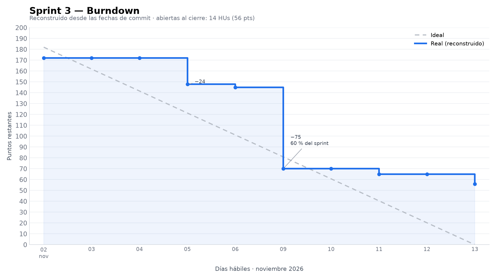

# Sprint 3 — Burndown



> **Gráfico reconstruido.** Jira conserva el estado final de cada historia y no el histórico de
> puntos por día. La curva se reconstruye desde la fecha del commit que evidencia cada historia.

## Método

1. Se asigna cada historia cerrada al commit que la evidencia.
2. Los commits de fin de semana, del 7 y 8 de noviembre, se imputan al lunes 9, primer día hábil
   siguiente.
3. La línea ideal reparte 182 puntos entre los **9 intervalos** de los 10 días hábiles, del 2 al 13
   de noviembre. Equivale a 20,2 puntos por día y llega a cero el día 13.

## Tabla

| Día hábil | Ideal | Real | Se cierran |
|---|---|---|---|
| 02 nov | 182,0 | 172 | TEC-04, TEC-05 (−10) |
| 03 nov | 161,8 | 172 | — |
| 04 nov | 141,6 | 172 | — |
| 05 nov | 121,3 | 148 | TEC-02, TEC-13, TEC-19, TEC-14, CFG-19 (−24) |
| 06 nov | 101,1 | 145 | AUT-3 (−3) |
| 09 nov | 80,9 | **70** | CFG-15, INV-3, INV-4, TEC-07, INV-5, INV-7, SIM-01, SIM-03, SIM-04, SIM-05, SIM-06, SIM-07, SIM-08 (−75) |
| 10 nov | 60,7 | 70 | — |
| 11 nov | 40,4 | 65 | TEC-06 (−5) |
| 12 nov | 20,2 | 65 | — |
| 13 nov | 0,0 | 56 | TEC-11, TEC-15, AUT-4 (−9) |

## Aritmética del cierre

```
Comprometido           182 pts  (39 HUs)
Cerrado en el sprint   126 pts  (25 HUs)
Abierto al cierre       56 pts  (14 HUs)
Cumplimiento           126 / 182 = 69 %
```

## Lectura

- **La línea real permanece por encima de la ideal durante todo el sprint.** No existe un solo día
  en que el proyecto vaya adelantado. El sprint nació sobrecomprometido.
- **El 9 de noviembre se cierra el 60 % del sprint**, con 75 puntos en un día. Coincide con el
  cierre de F7: optimizador, historial y habilidades ingresaron en un solo commit (`da98ffb`).
- **La brecha final es de 56 puntos**, todos de configuración y comunidad: HUB-02, HUB-21 a HUB-23,
  CFG-03, CFG-04, CFG-13, CFG-14, CFG-16, CFG-20, INV-6, SIM-02 y dos historias técnicas en
  revisión.
- **El ritmo fue el más alto del proyecto**, con 126 puntos en diez días hábiles, frente a 35 en el
  Sprint 1 y 27 en el Sprint 2. El porcentaje bajo refleja un problema de planificación y no de
  velocidad.

## Límite del dato

La atribución por día constituye una reconstrucción. Un solo commit puede cerrar varias historias,
y el documento no afirma que cada punto se haya ganado el día que figura. Afirma que ese día
aparece la evidencia que lo respalda.
