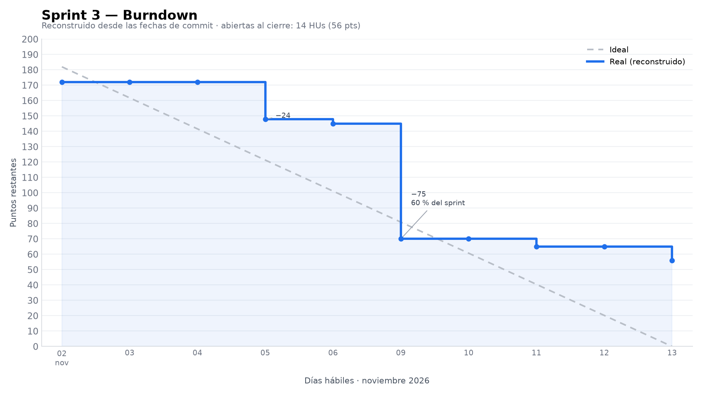

# Sprint 3 — Planning

**Fechas:** 2 al 15 de noviembre de 2026
**Estado en Jira:** cerrado el 20 de noviembre de 2026
**Objetivo del sprint (registrado en Jira):** Dexie, hub con Supabase, cuentas, F6.1 a F6.4, F7 y
la hoja de personaje.

## Contexto de partida

El Sprint 2 dejó el esquema, las políticas RLS y las fórmulas. Faltaba la aplicación: pantallas,
navegación, persistencia local y datos reales en lugar de fixtures.

Este es el sprint más grande del proyecto y el único donde coinciden tres frentes simultáneos:
infraestructura de la aplicación, inventario y simulación. No puede reducirse sin dejar la entrega
a medias, por lo que se asume el riesgo y se planifica por funcionalidad y no por capa.

## Alcance comprometido

Treinta y nueve historias de usuario, con un total de **182 puntos**.

| Épica | HUs | Puntos |
|---|---|---|
| Infraestructura (TEC) | 12 | 48 |
| Simulación (SIM) | 8 | 55 |
| Configuración de juegos (CFG) | 8 | 39 |
| Inventario (INV) | 5 | 20 |
| Optimizadores comunitarios (HUB) | 4 | 14 |
| Autenticación y perfil (AUT) | 2 | 6 |
| **Total** | **39** | **182** |

> El total de puntos supera al de cualquier sprint anterior porque incluye historias estimadas
> durante el ordenamiento del 20 de noviembre. Al planificar, ocho historias técnicas de este
> sprint no tenían estimación.

## Criterios de aceptación del sprint

- La aplicación navega y persiste sin Supabase mediante Dexie, y con Supabase mediante el
  repositorio remoto.
- El inventario permite crear, ver, modificar, borrar, importar y exportar.
- El optimizador devuelve una build equipable y no solo números.
- Las estadísticas se comparan en una sola vista: actual, previa y futura.
- CI se ejecuta en GitHub Actions sobre cada pull request.

## Riesgos identificados al inicio

| Riesgo | Mitigación aplicada |
|---|---|
| 39 historias en dos semanas | se prioriza F6 y F7; lo no iniciado regresa al backlog al cerrar |
| Dos fuentes de datos, local y remoto, que divergen | repositorios separados con la misma interfaz; el local es caché y no la fuente de verdad |
| El motor tarda y bloquea la interfaz | límite de tiempo configurable en segundos y clave de caché por contenido real |
| La hoja de personaje duplica el cálculo del optimizador | una sola función de cálculo y dos vistas que la consumen |

## Resultado

Se completaron 126 de 182 puntos, un **69 %**. Es el cumplimiento más bajo de los cuatro sprints y
el único caso en que el alcance superó la capacidad. Catorce historias que no se iniciaron quedaron
arrastradas al Sprint 4.

## Nota sobre el tamaño

Planificar 182 puntos en diez días hábiles constituyó un error de estimación y no de ejecución. Se
completaron 126 puntos, más que en cualquier sprint anterior. El problema no fue el ritmo, sino
haber comprometido el doble de lo que el equipo venía entregando.
