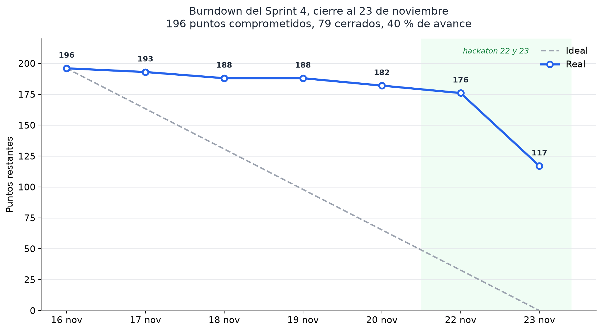

# Sprint 4 — Burndown



**Ventana real:** 16 al 23 de noviembre, seis días hábiles. Jira fecha el sprint del 16 al 29, pero
el equipo lo cierra el 23 a medianoche porque la entrega se presenta el 24.

**Alcance al cierre:** 46 historias y 196 puntos. Al abrir eran 39 historias y 162 puntos. Las siete
historias restantes son trabajo real que se hizo estos días y no existía en Jira: análisis estático,
Docker, pipeline de integración continua, documentación, catálogo normalizado, guardado en la cuenta
y lectura portable de fixtures.

## Tabla

| Día hábil | Ideal | Real | Se cierran |
|---|---|---|---|
| 16 nov | 196,0 | 196 | — |
| 17 nov | 163,3 | 193 | TEC-25 Docker (−3) |
| 18 nov | 130,7 | 188 | TEC-24 SonarQube (−5) |
| 19 nov | 98,0 | 188 | — |
| 20 nov | 65,3 | 196 | CFG-05 y SP-01 (−6) |
| 22 nov | 32,7 | 176 | CFG-06 y CFG-01 (−6) |
| 23 nov | 0,0 | **117** | resto del incremento (−59) |

## Aritmética al cierre

```
Comprometido            196 pts  (46 HUs)
Cerrado                  79 pts  (20 HUs)
Restante                117 pts  (26 HUs)
Avance                   40,3 %
Días hábiles transcurridos  6 de 6
```

## Lectura

- **La curva se mantiene plana hasta el 20 de noviembre.** El trabajo de esos días fue
  infraestructura y documentación: Docker, SonarQube, pipeline de integración continua y la
  reescritura de los documentos técnicos. Es trabajo que no cierra historias de producto, pero sí
  cierra las de infraestructura.
- **La hackatón del 22 y 23 concentra el 75 % de lo cerrado.** Antes de esos dos días había 20
  puntos cerrados; al terminar había 79. La jornada presencial fue la que movió la curva.
- **El editor quedó demostrable.** CFG-05, CFG-06 y CFG-01 a CFG-04 están cerrados y verificados en
  el repositorio. Un usuario puede crear un juego desde cero, listar sus atributos, editarlos,
  eliminarlos y ver la configuración completa.
- **La brecha con la línea ideal se cierra a 117 puntos.** Cerrarla habría exigido entregar el
  editor de variables completo, la comunidad y las suscripciones. Ninguna de las tres estaba
  planificada para este sprint.

## Qué se agregó al alcance y por qué

| Historia nueva | Puntos | Por qué no estaba en Jira |
|---|---|---|
| TEC-24 SonarQube | 5 | se implementó el 18 de noviembre, después de la última revisión del backlog |
| TEC-25 Docker | 3 | igual que la anterior, entró el 17 de noviembre |
| TEC-26 Documentación | 8 | trabajo sostenido de los cuatro sprints, sin tarjeta propia |
| TEC-27 Catálogo normalizado | 5 | la columna `category` se reemplazó por dos tablas normalizadas |
| TEC-28 Pipeline de CI | 5 | el workflow creció por encima de lo que declaraba TEC-14 |
| TEC-29 Fixtures portables | 3 | el arreglo apareció al correr las pruebas en Windows |
| CFG-22 Guardar en la cuenta | 5 | funcionalidad nueva, sin historia previa |

Estas siete historias suman 34 puntos y explican la diferencia entre los 162 puntos que Jira tenía
al abrir y los 196 al cerrar.

## Qué observar en el cierre

Los dos indicadores que se declararon al abrir el sprint:

1. **Cuántas historias llegaron a «Listo».** Llegaron 20 de 46. Ninguna quedó en un estado
   intermedio sin verificación: lo que está en «Listo» tiene commit que lo respalda.
2. **Si el editor quedó en un estado demostrable.** Quedó. Es lo que se presenta el 24.

El punto 2 tiene respuesta verificable en el repositorio y en la documentación del sprint. El punto
1 se responde con la tabla anterior.

## Lo que este gráfico no muestra

La curva mide puntos, no esfuerzo. Las 91 confirmaciones de código de estos ocho días no se
distribuyen según el tamaño de las historias. Un día con tres confirmaciones puede cerrar cinco
puntos o ninguno, y este sprint tuvo ambos casos.

Tampoco muestra el trabajo que no cierra historias: la reescritura de la documentación técnica, que
son ocho documentos y seis ADR, se hizo en cuatro jornadas.
