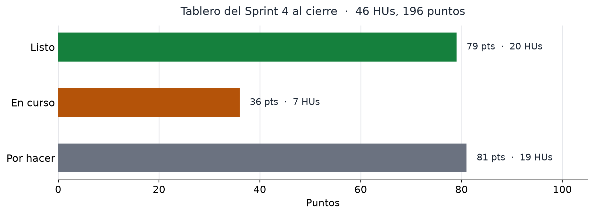

# Sprint 4 — Scrumboard



> **Render y no captura.** Se genera desde los datos de la API de Jira al 24 de noviembre de 2026.
> Las tarjetas se movieron a su estado real, pero el sprint no se finalizó en Jira.

## Columnas

| Columna | HUs | Puntos |
|---|---|---|
| **Listo** | 20 | 79 |
| **En curso** | 7 | 36 |
| **Por hacer** | 19 | 81 |
| **Total** | **46** | **196** |

No hay tarjetas en «En revisión». Al cierre se revisó cada historia y se llevó directamente a su
estado definitivo: «Listo» cuando el código lo respalda, «En curso» cuando no.

## Qué contiene cada columna

**Listo.** Veinte historias con commit verificable. Seis del editor de atributos (CFG-01 a CFG-06),
cuatro de infraestructura y calidad (SonarQube, Docker, pipeline y fixtures), dos de persistencia y
catálogo, y ocho de plataforma y cierre.

**En curso.** Las siete historias del editor de variables: variable simple, derivada, dos de valores
por categoría, variantes, edición de optimizadores y refinamiento de historias. Empezaron y
quedaron a mitad de camino. El código de variables no existe todavía.

**Por hacer.** Diecinueve historias que no estaban planificadas para este sprint: configuración
avanzada, comunidad, suscripciones y técnicas del cierre. Se mantienen visibles como pendiente
declarado, no como deuda oculta.

## Flujo de trabajo

```
Por hacer  →  En curso  →  En revisión  →  Listo
```

## Observación

Este tablero tiene una forma distinta a la de los sprints anteriores: por primera vez hay más
trabajo cerrado que pendiente en el bloque que importa.

Sprints 1 a 3 terminaron con casi todo en «Listo» y nada en curso, porque el trabajo se integraba por
funcionalidad completa. Este termina con 20 cerradas y 7 en curso, y ese estado intermedio es real:
son las historias que se empezaron y no se alcanzaron.

La columna «En revisión» quedó vacía porque el cierre se verificó contra el repositorio y no contra
la memoria del equipo. Una historia con código verificado pasa a «Listo» sin pasar por revisión, y
una sin código vuelve a «En curso». El estado intermedio no aporta nada cuando la verificación es
directa.

## Comparación con el tablero del 20 de noviembre

| Columna | 20 nov | 23 nov |
|---|---|---|
| Listo | 1 | 20 |
| En revisión | 4 | 0 |
| En curso | 7 | 7 |
| Por hacer | 27 | 19 |

Las cuatro historias que estaban en revisión se verificaron y cerraron. Las siete en curso siguen en
curso: no avanzaron, y el tablero lo dice.
