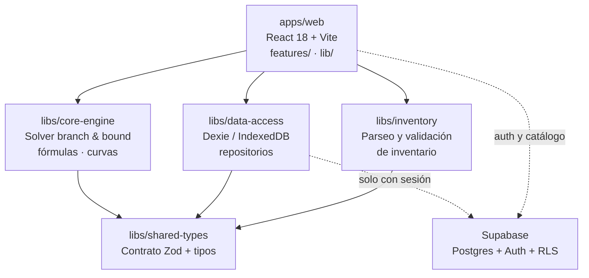
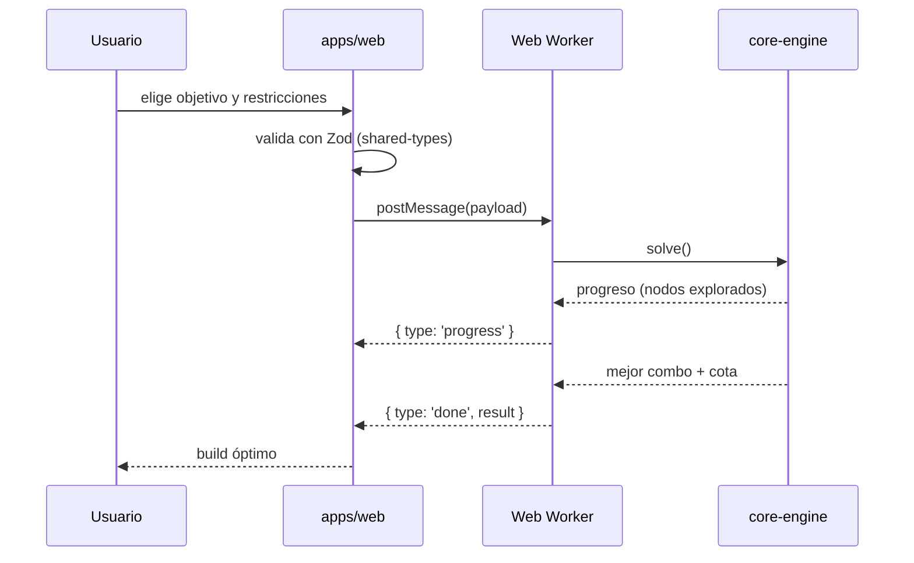
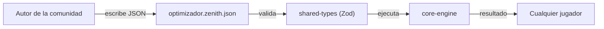
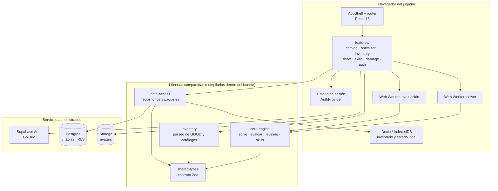
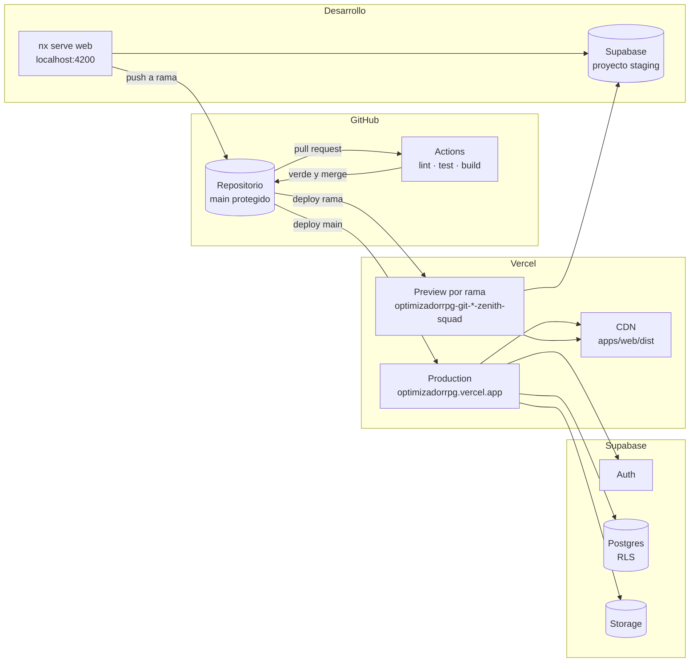

# Arquitectura

Zenith Optimizer es una aplicación **client-side**: el cálculo ocurre en el navegador y el
servidor nunca resuelve una optimización. Todo lo demás se deriva de esa decisión.

## Principio rector

> **El servidor guarda y reparte; nunca calcula.**

El solver explora combinaciones de inventario × habilidades, un espacio que crece de forma
explosiva. Ejecutarlo en el cliente tiene tres consecuencias que definen el producto:

1. **Costo marginal cero por usuario.** No hay cómputo que escalar ni cola de trabajos.
2. **El inventario no sale del dispositivo.** Es la privacidad como propiedad del diseño, no
   como promesa.
3. **Funciona sin conexión.** El motor no depende de una API para dar un resultado.

## Capas

| Capa | Responsabilidad | No hace |
|---|---|---|
| `apps/web` | UI, rutas, estado de sesión | calcular estadísticas |
| `libs/core-engine` | Resolver la mejor combinación | tocar DOM o almacenamiento |
| `libs/data-access` | Persistir y leer del navegador | reglas de negocio |
| `libs/inventory` | Interpretar formatos de inventario | dependender de un juego concreto |
| `libs/shared-types` | Definir el contrato | contener lógica |
| Supabase | Guardar y repartir | calcular |

`core-engine` es TypeScript puro: sin React, sin DOM, sin almacenamiento. Esa pureza es lo
que permite probarlo con 130 casos unitarios sin montar un navegador.

## Flujo de una optimización

El Worker existe por una razón concreta: la búsqueda puede tardar segundos y bloquearía el
hilo de UI. Al moverla a un Worker, el progreso se puede dibujar mientras el motor trabaja.

## Por qué el resultado es exacto

El motor no aproxima. Usa **branch and bound** con dos cotas superiores:

- En cada nodo se acota el mejor valor alcanzable antes de explorar sus hijos.
- Si la cota no supera al mejor encontrado, la rama se poda y no se expande.

Las cotas son válidas por construcción (nunca subestiman), así que si la búsqueda termina,
**el óptimo está demostrado**. El resultado lo declara en `provenOptimal` e incluye el
número de nodos podados, para que la garantía sea auditable y no una afirmación de README.

No hay un segundo algoritmo heurístico: es la **misma** búsqueda con un presupuesto de
tiempo opcional. Sin límite (`Infinity`) recorre el espacio completo; con límite, al agotarse
corta y devuelve lo mejor encontrado con `provenOptimal: false` y `stoppedBy: 'tiempo'`. El
resultado siempre dice qué garantía tiene, así que un build "no probado" nunca se confunde
con uno óptimo.

## El contrato es el producto

Un optimizador es un JSON que describe un juego: estadísticas, slots, restricciones,
variables derivadas. No hay código específico por juego.

Consecuencia: **agregar un juego no requiere tocar el motor**. Ni el backend. Solo un archivo
que cumpla el contrato.

## Datos

- **Inventario y perfiles:** IndexedDB vía Dexie (`libs/data-access`). Local por defecto.
- **Cuentas, catálogo comunitario, votos, favoritos:** Supabase. Opcional — sin
  `VITE_SUPABASE_URL` la app funciona con fixtures locales.
- **Regla de exposición:** la `anon key` viaja al navegador por diseño; lo que protege los
  datos son las políticas RLS de Postgres, no el secreto de la clave.

El modelo relacional completo, con sus relaciones y su justificación de normalización, está en
[`modelo-de-datos.md`](./modelo-de-datos.md).

## Componentes

Qué se ejecuta dentro del navegador y qué queda del lado del servidor:

| Componente | Tipo | Responsabilidad |
|---|---|---|
| `AppShell` + router | cliente | navegación y layout |
| `features/*` | cliente | una carpeta por dominio funcional |
| worker del solver | cliente | cálculo pesado fuera del hilo de la interfaz |
| worker de evaluación | cliente | auditar un número sin interrumpir una búsqueda |
| `core-engine` | librería | resuelve; no conoce React ni el DOM |
| `data-access` | librería | persistencia y empaquetado |
| `inventory` | librería | interpreta formatos de terceros |
| `shared-types` | librería | contrato validado con Zod |
| Supabase Auth | servicio | registro, sesión y confirmación por correo |
| Postgres | servicio | datos compartidos, protegidos por RLS |
| Storage | servicio | avatares de perfil |

## Despliegue

Dos entornos de ejecución y un artefacto estático. No hay servidor de aplicación propio: el
cálculo no lo necesita y la API la presta Supabase.

| Entorno | Dónde | Base de datos | Variables |
|---|---|---|---|
| Desarrollo | `localhost:4200` | staging | `.env.local` con prefijo `VITE_` |
| Preview | Vercel, una por rama | staging | scope **Preview** |
| Producción | `optimizadorrpg.vercel.app` | producción | scope **Production** |

**Por qué ningún preview toca producción:** las variables `VITE_*` se hornean en el build, y
cada entorno tiene su propio scope. Un preview de una rama escribe en staging, así que probar
no puede alterar los datos reales. La separación no depende de que alguien recuerde usar el
entorno correcto: depende de qué variables recibió el build.

Ver `docs/entornos.md` para la matriz de ambientes y `README.md` para el procedimiento.
