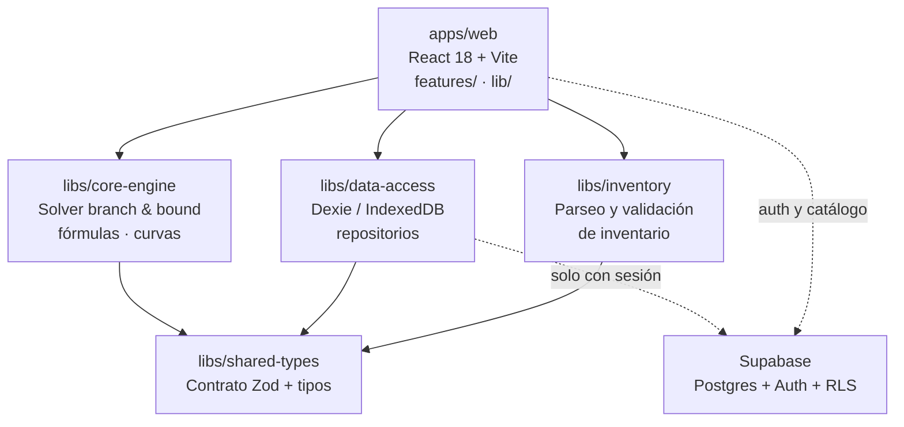
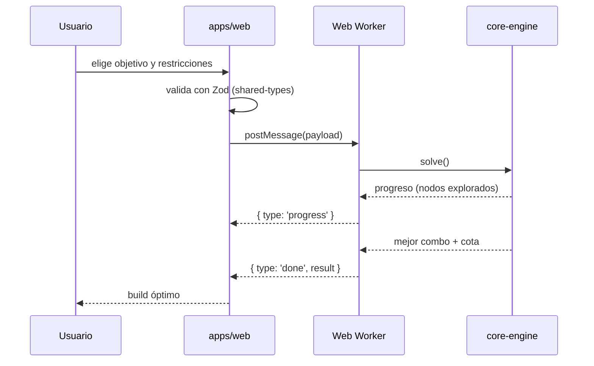
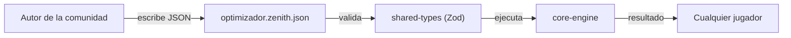

# Arquitectura

Zenith Optimizer es una aplicación **client-side**: el cálculo ocurre en el navegador y el
servidor nunca resuelve una optimización. Todo lo demás se deriva de esa decisión.

## Principio rector

> **El servidor guarda y reparte; nunca calcula.**

El solver explora combinaciones de inventario × habilidades, un espacio que crece de forma
explosiva. Ejecutarlo en el cliente tiene tres consecuencias que definen el producto:

1. **Costo marginal cero por usuario.** No hay cómputo que escalar ni cola de trabajos.
2. **El inventario no sale del dispositivo.** Es la privacidad como propiedad del diseño, no
   como promesa.
3. **Funciona sin conexión.** El motor no depende de una API para dar un resultado.

## Capas

| Capa | Responsabilidad | No hace |
|---|---|---|
| `apps/web` | UI, rutas, estado de sesión | calcular estadísticas |
| `libs/core-engine` | Resolver la mejor combinación | tocar DOM o almacenamiento |
| `libs/data-access` | Persistir y leer del navegador | reglas de negocio |
| `libs/inventory` | Interpretar formatos de inventario | dependender de un juego concreto |
| `libs/shared-types` | Definir el contrato | contener lógica |
| Supabase | Guardar y repartir | calcular |

`core-engine` es TypeScript puro: sin React, sin DOM, sin almacenamiento. Esa pureza es lo
que permite probarlo con 130 casos unitarios sin montar un navegador.

## Flujo de una optimización

El Worker existe por una razón concreta: la búsqueda puede tardar segundos y bloquearía el
hilo de UI. Al moverla a un Worker, el progreso se puede dibujar mientras el motor trabaja.

## Por qué el resultado es exacto

El motor no aproxima. Usa **branch and bound** con dos cotas superiores:

- En cada nodo se acota el mejor valor alcanzable antes de explorar sus hijos.
- Si la cota no supera al mejor encontrado, la rama se poda y no se expande.

Las cotas son válidas por construcción (nunca subestiman), así que si la búsqueda termina,
**el óptimo está demostrado**. El resultado lo declara en `provenOptimal` e incluye el
número de nodos podados, para que la garantía sea auditable y no una afirmación de README.

No hay un segundo algoritmo heurístico: es la **misma** búsqueda con un presupuesto de
tiempo opcional. Sin límite (`Infinity`) recorre el espacio completo; con límite, al agotarse
corta y devuelve lo mejor encontrado con `provenOptimal: false` y `stoppedBy: 'tiempo'`. El
resultado siempre dice qué garantía tiene, así que un build "no probado" nunca se confunde
con uno óptimo.

## El contrato es el producto

Un optimizador es un JSON que describe un juego: estadísticas, slots, restricciones,
variables derivadas. No hay código específico por juego.

Consecuencia: **agregar un juego no requiere tocar el motor**. Ni el backend. Solo un archivo
que cumpla el contrato.

## Datos

- **Inventario y perfiles:** IndexedDB vía Dexie (`libs/data-access`). Local por defecto.
- **Cuentas, catálogo comunitario, votos, favoritos:** Supabase. Opcional — sin
  `VITE_SUPABASE_URL` la app funciona con fixtures locales.
- **Regla de exposición:** la `anon key` viaja al navegador por diseño; lo que protege los
  datos son las políticas RLS de Postgres, no el secreto de la clave.

## Despliegue

El artefacto es estático: `apps/web/dist`. Se sirve desde cualquier CDN. Como es una SPA,
el servidor debe devolver `index.html` en rutas sin archivo. Las variables `VITE_*` se
hornean en el build, así que cada entorno construye su propio bundle.

Ver `docs/entornos.md` para la matriz de ambientes y `README.md` para el procedimiento.
