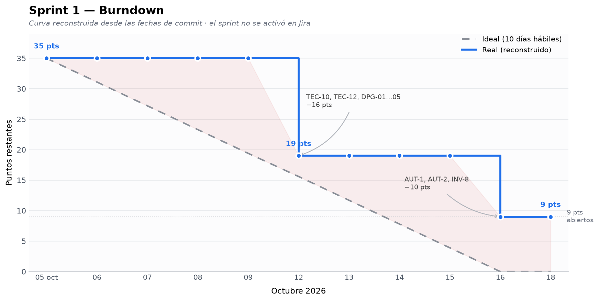

# Sprint 1 — Burndown



> **Gráfico reconstruido.** El sprint nunca se activó en Jira mientras se trabajaba, así que no
> existe historial de puntos por día. La curva se reconstruye a partir de las fechas de commit y
> del estado final de cada HU. Se declara explícitamente para no presentar como medición lo que
> es una estimación.

## Método de reconstrucción

1. Se toma la fecha del commit que evidencia cada HU.
2. Cada día se descuentan los puntos de las HUs cuyo primer commit aparece ese día o antes.
3. La línea ideal reparte 35 puntos entre los **10 días hábiles** del sprint (5 al 16 de octubre).

## Tabla

| Día | Ideal restante | Real restante | HUs que cierran |
|---|---|---|---|
| 05 oct | 35,0 | 35 | — |
| 06 oct | 31,1 | 35 | bootstrap y demo: sin puntos de HU |
| 07 oct | 27,2 | 35 | — |
| 08 oct | 23,3 | 35 | — |
| 09 oct | 19,4 | 35 | — |
| 12 oct | 15,6 | **19** | TEC-10, TEC-12, DPG-01 a DPG-05 (−16) |
| 13 oct | 11,7 | 19 | Supabase, sin cierre de HU |
| 14 oct | 7,8 | 19 | — |
| 15 oct | 3,9 | 19 | — |
| 16 oct | 0,0 | **9** | AUT-1, AUT-2, INV-8 (−10) |
| 18 oct | 0,0 | **9** | cierre del sprint |

## Aritmética del cierre

```
Comprometido          35 pts
Cerrado en el sprint  26 pts  (TEC-10, TEC-12, DPG-01…05, AUT-1, AUT-2, INV-8)
Abierto al cierre      9 pts  (CFG-05, CFG-06, SP-02)
Cumplimiento          26 / 35 = 74 %
```

## Lectura

- **La curva es escalonada, no diagonal.** Cinco días sin cierre y dos caídas netas (12 y 16 de
  octubre). Es el patrón de trabajo concentrado en sesiones, no de dedicación diaria pareja.
- **Termina 9 puntos por encima de la línea ideal**, que son exactamente los tres HUs trasladadas
  al Sprint 2. No hay desvío no explicado: todo punto abierto tiene destino.
- **El hueco no creció a mitad de sprint.** La distancia con el ideal pasó de ~16 puntos el 12 de
  octubre a 9 al cierre: el trabajo aceleró al final, no se estancó.

## Datos que respaldan la curva

```
2026-10-06  chore/bootstrap monorepo (#1)
2026-10-06  feat(demo): prototipo v2 con niveles, habilidades y Supabase (#2)
2026-10-12  feat(core-engine): motor portado desde el prototipo con pruebas
2026-10-12  feat(shared-types): contrato de juego completo con Zod
2026-10-13  sql_supabase, vercel.json, evidencia Fase 2
```
