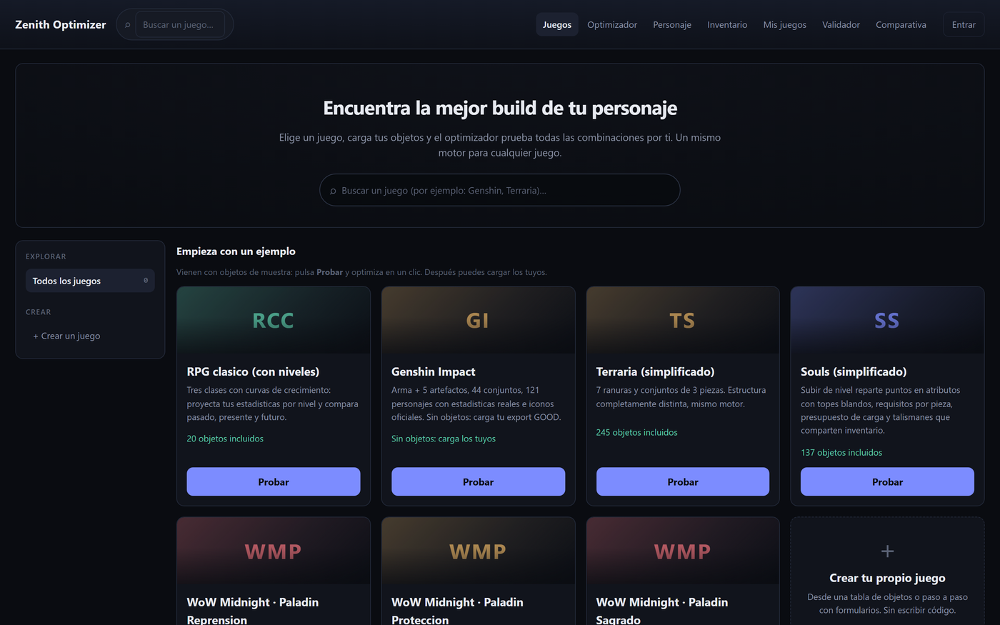
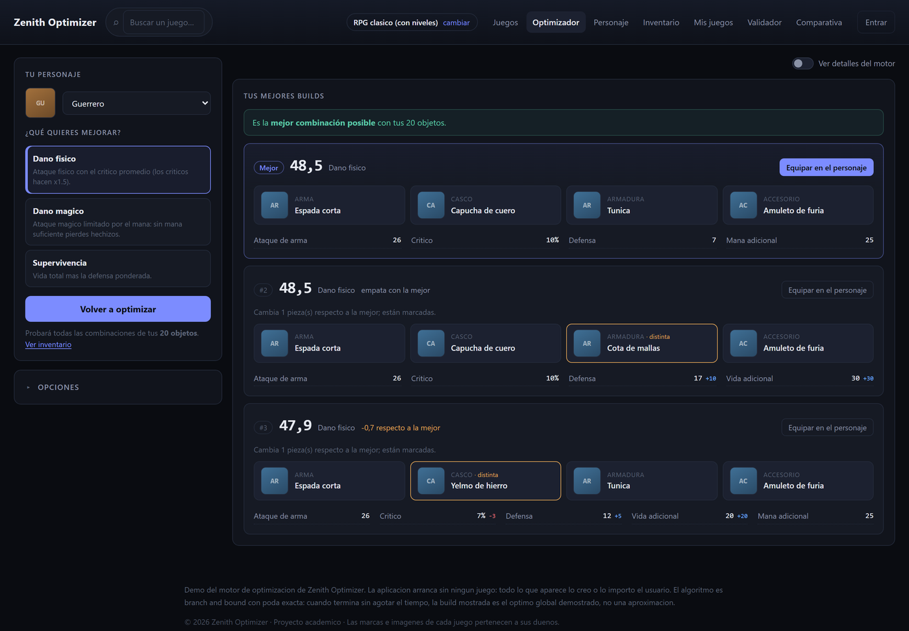
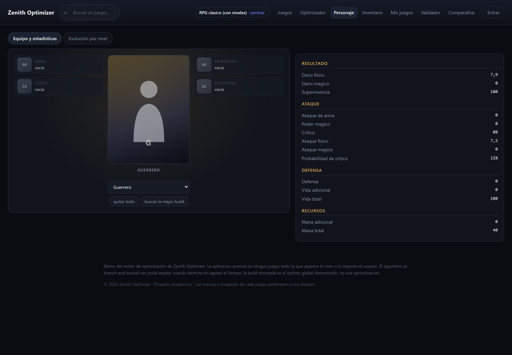

# Sprint 1 — Review

**Fecha:** 18 de octubre de 2026
**Objetivo del sprint:** prototipo del Core Engine y port del motor a `libs/core-engine`.

## Resultado contra el objetivo

**Cumplido.** El motor está portado, probado y sin dependencias de la UI ni de la red, que era el
criterio de aceptación declarado.

| Métrica | Valor |
|---|---|
| Puntos comprometidos | 35 |
| Puntos completados | 29 |
| Cumplimiento | **83 %** |
| HUs cerradas | 11 de 13 |

## Incremento demostrable

**1. El motor funciona y está probado**

`libs/core-engine` expone el cálculo de mejor combinación. Las pruebas cubren casos conocidos y
borde: inventario vacío, restricciones sin solución y múltiples objetivos.

```
npx nx test @zenith/core-engine
```

**2. El prototipo demuestra el producto completo**

`demo/` muestra el flujo entero: elegir juego, subir de nivel, recorrer el árbol de habilidades y
ver la hoja de personaje resultante.

### Catálogo del prototipo



### El motor devolviendo la mejor combinación

Resultado con 20 objetos: la build óptima, dos alternativas a una pieza de distancia y las
estadísticas derivadas de cada una.



### Hoja de personaje



> Capturas tomadas del prototipo (`demo/`) al estado del PR #2, servido en local. El prototipo
> arranca sin juego cargado: los datos de las capturas son el juego de ejemplo que trae la demo.

**3. El contrato de juego está definido**

`libs/shared-types` valida una plantilla completa con Zod. Es la base de todo lo que viene: sin
contrato, cada vista inventaría su propia forma de datos.

**4. Autenticación e inventario en la nube**

Registro, inicio de sesión y persistencia del inventario. El esquema de Supabase existe y las
migraciones son idempotentes.

## Qué no se demostró, y por qué

| HU | Motivo | Destino |
|---|---|---|
| CFG-05, CFG-06 | Necesitan el editor, que depende del contrato recién creado | Sprint 4 |

## Observaciones de la review

- **El 83 % no es un sprint fallido.** El objetivo declarado era el motor, y el motor está
  completo. Lo abierto es de producto, no de la pieza central.
- **El prototipo cumplió su función y se congela.** A partir de aquí, toda evidencia se produce
  en el monorepo; `demo/` queda como referencia histórica del PR #2.
- **Tag `sprint-1` sobre el último commit de la ventana** (`8c78dd5`). El incremento deja de
  identificarse por fecha y pasa a identificarse por etiqueta.
