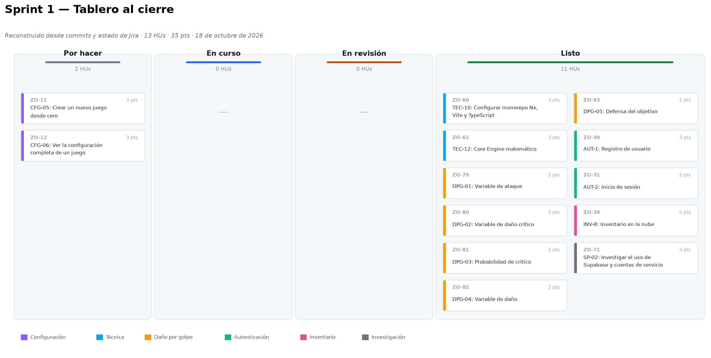

# Sprint 1 — Scrumboard



> **Reconstrucción, no captura.** Jira no se usó como fuente de verdad durante el sprint: al
> cierre, el Sprint 1 tenía **3 HUs asignadas** (ZO-11, ZO-12 y ZO-71). Las otras diez se
> completaron en las mismas fechas pero nunca se asignaron al sprint.
>
> Este tablero reconstruye el estado del trabajo a partir de los commits y del estado de cada HU
> en Jira. La asignación de las diez HUs al sprint se corrige en el ordenamiento de Jira, y
> entonces esta imagen se reemplaza por una captura del tablero real.

## Columnas

| Columna | HUs |
|---|---|
| **Por hacer** | ZO-11 (CFG-05), ZO-12 (CFG-06) |
| **En curso** | — |
| **En revisión** | — |
| **Listo** | ZO-30, ZO-31, ZO-39, ZO-60, ZO-62, ZO-71, ZO-79, ZO-80, ZO-81, ZO-82, ZO-83 |

## Flujo de trabajo

```
Por hacer  →  En curso  →  En revisión  →  Listo
```

La columna **En revisión** existe para PRs abiertos con CI en verde pero sin merge. En este
sprint no se usó: los dos PRs entraron directos porque no había otros revisores además del
autor.

## Distribución por épica

| Épica | HUs listas | HUs abiertas |
|---|---|---|
| Técnica (TEC) | 2 | — |
| Daño por golpe (DPG) | 5 | — |
| Autenticación (AUT) | 2 | — |
| Inventario (INV) | 1 | — |
| Investigación (SP) | 1 | — |
| Configuración (CFG) | — | 2 |

## Observación

Once de trece HUs cerraron y todas las épicas con alcance técnico quedaron completas. Lo
abierto es de **producto** (editor de configuración), no de motor ni de decisión. Eso explica
que el sprint cumpliera su objetivo declarado aunque no cerrara el 100 % del alcance.
