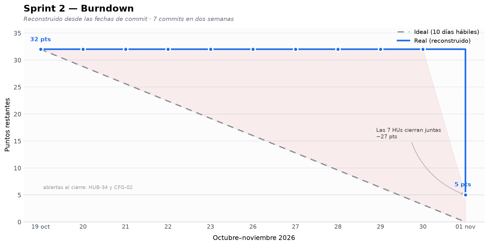

# Sprint 2 — Planning

**Fechas:** 19 de octubre al 1 de noviembre de 2026
**Estado en Jira:** cerrado el 20 de noviembre de 2026
**Objetivo del sprint (registrado en Jira):** rediseño visual, catálogo con portadas y esquema
Supabase en el repo con pruebas RLS.

## Contexto de partida

El Sprint 1 dejó el motor portado y probado, pero la aplicación no existía todavía. Este sprint
cambia el eje: deja de probar que el cálculo funciona y empieza a construir el producto que lo
usa.

El trabajo se reparte en tres frentes que no dependen entre sí:

1. **Catálogo** — listar optimizadores comunitarios con identidad visual, no una tabla de texto.
2. **Esquema de datos** — llevar el modelo a migraciones versionadas en el repositorio, no a la
   consola de Supabase.
3. **Fórmulas de daño** — cerrar las tres variantes que el motor necesita para puntuar builds.

## Alcance comprometido

9 historias de usuario, **32 puntos**:

| Épica | HU | Puntos |
|---|---|---|
| Configuración de juegos | CFG-02, CFG-10 | 7 |
| Optimizadores comunitarios | HUB-01, HUB-34 | 8 |
| Inventario y catálogo | INV-1, INV-2 | 8 |
| Daño por golpe | DPG-06, DPG-07, DPG-08 | 9 |

## Criterio de aceptación del sprint

- El catálogo lee de Supabase y no inventa datos cuando no hay conexión.
- El esquema vive en `supabase/migrations/` y se puede aplicar desde cero.
- Las políticas RLS se prueban de forma automática, no a mano.
- Las tres fórmulas de daño devuelven valores verificables contra un caso conocido.

## Riesgos identificados al inicio

| Riesgo | Mitigación aplicada |
|---|---|
| Probar RLS requiere un Postgres real | `@electric-sql/pglite` embebido: las pruebas corren sin servidor |
| El catálogo depende de datos remotos para renderizar | Repositorio con tres modos: Supabase, mocks de e2e y catálogo vacío |
| Las fórmulas se dispersan entre vistas | Se concentran en la plantilla del juego y el motor solo las evalúa |

## Resultado

27 de 32 puntos completados (**84 %**). Las dos HUs que no cerraron (HUB-34 y CFG-02, 5 puntos)
se arrastraron al Sprint 4 durante el ordenamiento del 20 de noviembre.

## Nota sobre las fechas

Siete HUs se cerraron en Jira dentro de este sprint, pero el código equivalente en `apps/web`
tiene fecha del 5 al 9 de noviembre, ya en la ventana del Sprint 3. El detalle está en
`backlog.md`: se documenta el desfase en lugar de presentar como simultáneo lo que ocurrió en
dos momentos distintos.
