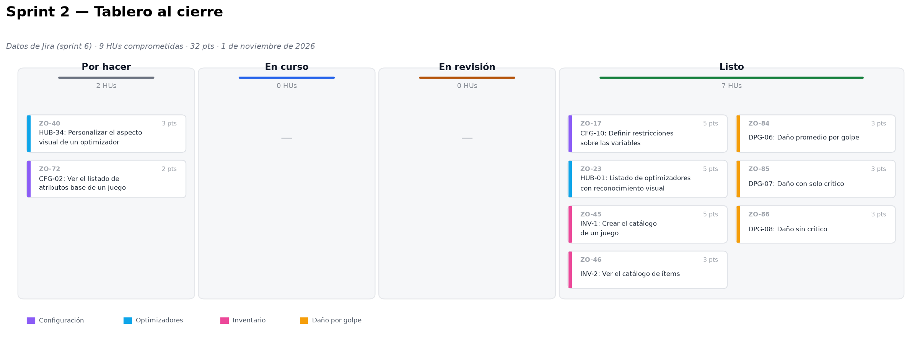

# Sprint 2 — Scrumboard



> **Render, no captura.** Generado desde los datos de Jira del sprint 6, que en el ordenamiento
> del 20 de noviembre quedó con 7 HUs; el tablero muestra las **9 comprometidas**, que es el
> alcance con el que se cerró el sprint. Las dos que no terminaron se arrastraron al Sprint 4.

## Columnas

| Columna | HUs |
|---|---|
| **Por hacer** | ZO-40 (HUB-34), ZO-72 (CFG-02) |
| **En curso** | — |
| **En revisión** | — |
| **Listo** | ZO-17, ZO-23, ZO-45, ZO-46, ZO-84, ZO-85, ZO-86 |

## Flujo de trabajo

```
Por hacer  →  En curso  →  En revisión  →  Listo
```

En este sprint **no se usó «En curso» ni «En revisión»**. Las HUs pasaron de Por hacer a Listo
cuando su evidencia entró al repositorio. Es una señal de proceso, no de virtud: sin estados
intermedios no hay forma de ver un bloqueo antes de que se convierta en retraso.

## Distribución por épica

| Épica | HUs listas | HUs abiertas |
|---|---|---|
| Configuración (CFG) | 1 | 1 |
| Optimizadores comunitarios (HUB) | 1 | 1 |
| Inventario y catálogo (INV) | 2 | — |
| Daño por golpe (DPG) | 3 | — |

## Observación

El sprint se concentró en tres bloques que no se parecen: catálogo (8 pts), esquema de datos
(5 pts) y fórmulas de daño (9 pts). Los tres comparten una característica: **son infraestructura
del producto**, no pantallas. Eso explica que el tablero se vea pequeño y el trabajo no lo fuera.
