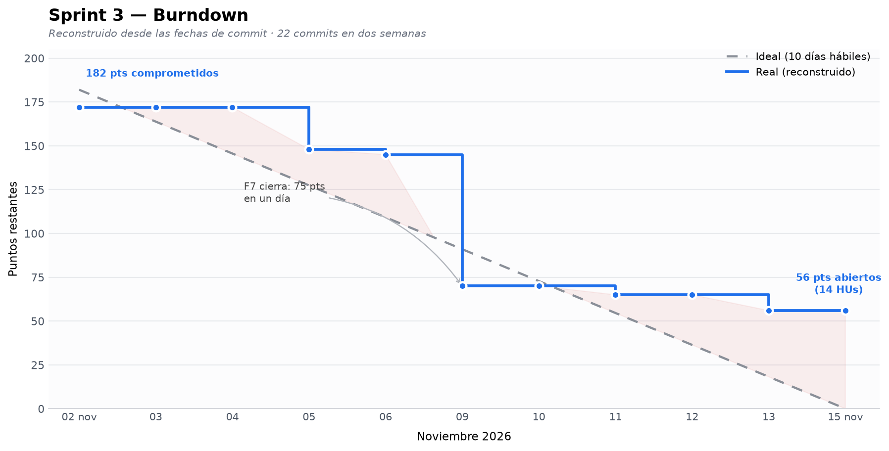

# Sprint 3 — Planning

**Fechas:** 2 al 15 de noviembre de 2026
**Estado en Jira:** cerrado el 20 de noviembre de 2026
**Objetivo del sprint (registrado en Jira):** Dexie, hub con Supabase, cuentas, F6.1 a F6.4, F7 y
la hoja de personaje.

## Contexto de partida

El Sprint 2 dejó el esquema, las políticas RLS y las fórmulas. Lo que faltaba era la aplicación:
pantallas, navegación, persistencia local y datos reales en lugar de fixtures.

Este es el sprint más grande del proyecto y el único donde coinciden tres frentes de trabajo
simultáneos: infraestructura de la app, inventario y simulación. No se puede reducir sin dejar la
entrega a medias, así que se asume el riesgo y se planifica por funcionalidad, no por capa.

## Alcance comprometido

39 historias de usuario, **182 puntos**.

| Épica | HUs | Puntos |
|---|---|---|
| Infraestructura (TEC) | 12 | 48 |
| Simulación (SIM) | 8 | 55 |
| Configuración de juegos (CFG) | 8 | 39 |
| Inventario (INV) | 5 | 20 |
| Optimizadores comunitarios (HUB) | 4 | 14 |
| Autenticación y perfil (AUT) | 2 | 6 |
| **Total** | **39** | **182** |

> El total de puntos es mayor que el de cualquier sprint anterior porque incluye HUs que se
> estimaron durante el ordenamiento del 20 de noviembre: al planificar, ocho HUs técnicas de este
> sprint no tenían estimación.

## Criterio de aceptación del sprint

- La aplicación navega y persiste sin Supabase (Dexie) y con Supabase (repositorio remoto).
- El inventario se puede crear, ver, modificar, borrar, importar y exportar.
- El optimizador devuelve una build equipable, no solo números.
- Las estadísticas se comparan en una sola vista: actual, previa y futura.
- CI corre en GitHub Actions sobre cada PR.

## Riesgos identificados al inicio

| Riesgo | Mitigación aplicada |
|---|---|
| 39 HUs en dos semanas | Se prioriza F6→F7; lo no empezado vuelve al backlog al cerrar |
| Dos fuentes de datos (local y remoto) divergen | Repositorios separados con la misma interfaz; el local es la caché, no la verdad |
| El motor tarda y bloquea la UI | Límite de tiempo configurable en segundos y clave de caché por contenido real |
| La hoja de personaje duplica el cálculo del optimizador | Una sola función de cálculo, dos vistas que la consumen |

## Resultado

126 de 182 puntos completados (**69 %**). Es el cumplimiento más bajo de los cuatro sprints y el
único donde el alcance fue mayor que la capacidad. Catorce HUs que no se empezaron quedaron
arrastradas al Sprint 4.

## Nota sobre el tamaño

Planificar 182 puntos en diez días hábiles fue un error de estimación, no de ejecución: se
completaron 126 puntos, más que en cualquier sprint anterior. El problema no fue el ritmo, fue
haber comprometido el doble de lo que el equipo venía entregando.
