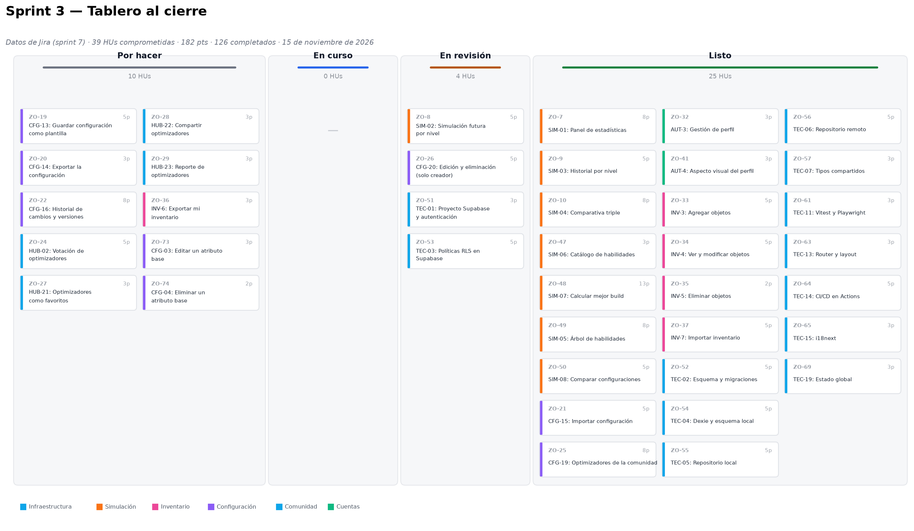

# Sprint 3 — Scrumboard



> **Render, no captura.** Generado desde los datos de Jira del sprint 7 más las 14 HUs que se
> arrastraron al Sprint 4 en el ordenamiento del 20 de noviembre. Se muestran las **39
> comprometidas**, que es el alcance con el que se cerró el sprint.

## Columnas

| Columna | HUs | Puntos |
|---|---|---|
| **Por hacer** | 10 | 38 |
| **En curso** | 0 | 0 |
| **En revisión** | 4 | 18 |
| **Listo** | 25 | 126 |

## Flujo de trabajo

```
Por hacer  →  En curso  →  En revisión  →  Listo
```

En este sprint **sí se usaron los estados intermedios**, que era la acción acordada en la
retrospectiva del Sprint 2. Se usaron a medias: cuatro HUs quedaron en «En revisión» y ninguna en
«En curso». El estado intermedio se aplicó al final del trabajo, no durante.

## Distribución por épica

| Épica | Listas | Revisión | Por hacer |
|---|---|---|---|
| Infraestructura (TEC) | 10 | 2 | — |
| Simulación (SIM) | 7 | 1 | — |
| Inventario (INV) | 4 | — | 1 |
| Configuración (CFG) | 2 | 1 | 5 |
| Comunidad (HUB) | — | — | 4 |
| Cuentas (AUT) | 2 | — | — |
| **Total** | **25** | **4** | **10** |

## Observación

El tablero muestra una forma que se repite en el proyecto: **las HUs técnicas y de simulación se
cierran; las de configuración y comunidad se acumulan en «Por hacer»**. No es azar. Las primeras
tienen criterio verificable y no dependen de nada; las segundas dependen del editor de juegos, que
no existía todavía.
