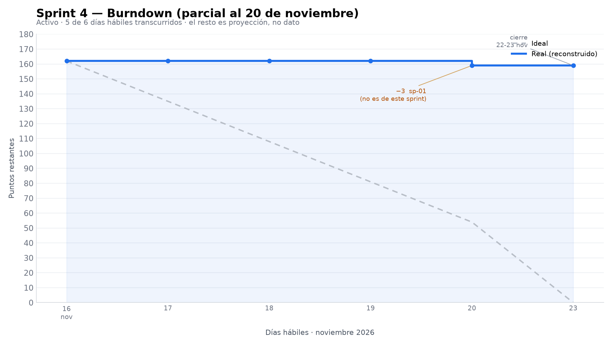

# Sprint 4 — Burndown



> **Gráfico parcial.** El gráfico se generó el 20 de noviembre y llega hasta ese día; lo que sigue
> es la proyección ideal, no un dato. La curva real al cierre no se dibuja aquí: exigiría volver a
> consultar Jira para saber qué HUs quedaron en «Listo» al 23, y ese dato no se tiene.
>
> **Ventana.** Jira fecha el sprint del 16 al 29 de noviembre, pero el equipo lo cierra el 23 a
> medianoche porque la entrega se presenta el 24. El burndown usa la ventana real de trabajo, no la
> del calendario de Jira: seis días hábiles, del 16 al 23.

## Tabla

| Día hábil | Ideal | Real | Se cierran |
|---|---|---|---|
| 16 nov | 162,0 | 162 | — |
| 17 nov | 135,0 | 162 | — |
| 18 nov | 108,0 | 162 | — |
| 19 nov | 81,0 | 162 | — |
| 20 nov | 54,0 | **159** | SP-01 (−3) |
| 23 nov | 0,0 | sin dato de Jira | — |

## Aritmética al 20 de noviembre

```
Comprometido            162 pts  (39 HUs)
Cerrado                   3 pts  (1 HU: SP-01)
Restante                159 pts
Avance                     1,9 %
Días hábiles transcurridos  5 de 6
```

## Lectura

- **La única HU cerrada no es de este sprint.** SP-01 es una evaluación de monorepos del sprint de
  arranque; se cerró el 20 de noviembre al ordenar Jira porque el monorepo existe desde septiembre.
  No representa avance de este sprint.
- **Siete HUs están en curso y ninguna cerrada.** El trabajo del editor de juegos está en marcha
  —atributos, variables simples, variables derivadas, variables por categoría y variantes— pero
  nada de eso se puede demostrar todavía.
- **La brecha con la línea ideal es de 105 puntos** al quinto día. Cerrarla exigiría entregar el
  editor completo, y algo más, en un solo día hábil.
- **El alcance incluye 28 HUs que llegaron en el ordenamiento del 20 de noviembre**: 18 arrastradas
  de los sprints 1 a 3, 9 que no tenían sprint y SP-01, que volvió desde el Sprint 0 para cerrarse.
  Con eso, la curva ideal no es alcanzable por construcción: buena parte de esos 162 puntos no se
  va a cerrar en este sprint.

## Qué mirar en el cierre

El sprint cierra el 23 de noviembre a medianoche. Los dos indicadores que importan son los mismos
que se declararon al abrir el sprint:

1. Cuántas de las 7 HUs en curso llegaron a «Listo», no cuántas se movieron de columna.
2. Si el editor quedó en un estado demostrable. Es lo que se muestra; TEC-22 ya no se espera para
   la entrega.

El punto 2 tiene respuesta verificable en el repositorio, y es afirmativa: al cierre existen CFG-05
completo (`17d444e`, `013e8b3`), CFG-06 (`6cff5b7`) y CFG-01 (`cec1a57`), con 700 casos de prueba
unitarios y de integración en verde. El punto 1 depende de Jira y no se declara sin consultarlo.
