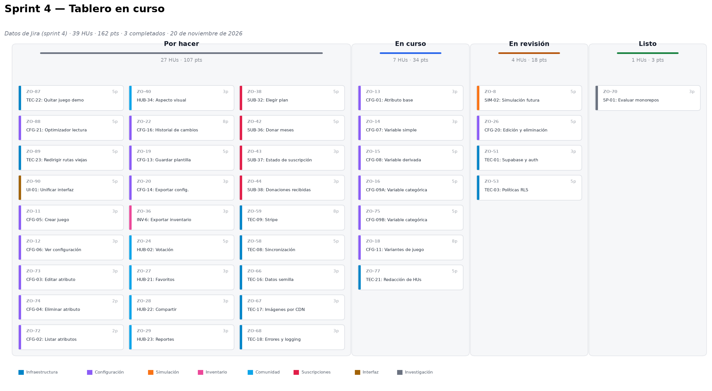

# Sprint 4 — Scrumboard



> **Render, no captura.** Generado desde los datos de Jira del sprint 4 el 20 de noviembre de 2026.
> El sprint cierra el 23 a medianoche; el tablero refleja esa foto y no se redibuja al cierre.

## Columnas

| Columna | HUs | Puntos |
|---|---|---|
| **Por hacer** | 27 | 107 |
| **En curso** | 7 | 34 |
| **En revisión** | 4 | 18 |
| **Listo** | 1 | 3 |

## Qué hay en cada columna

**En curso** — el editor de juegos: atributos base (CFG-01), variables simples (CFG-07), variables
derivadas (CFG-08), variables por categoría (CFG-09A y 09B), variantes (CFG-11) y el refinamiento de
la redacción de las HUs (TEC-21).

**En revisión** — trabajo terminado que espera verificación: simulación futura (SIM-02), edición de
optimizadores (CFG-20), Supabase y auth (TEC-01) y políticas RLS (TEC-03).

**Listo** — una sola: SP-01, evaluación de monorepos, cerrada al ordenar Jira.

**Por hacer** — 27 HUs, de las cuales solo 10 son del cierre de la entrega. Las otras 17 son
configuración avanzada, comunidad, suscripciones y técnicas que no se van a cerrar en este sprint y
se mantienen visibles como pendiente declarado.

## Flujo de trabajo

```
Por hacer  →  En curso  →  En revisión  →  Listo
```

## Observación

El tablero de este sprint tiene una forma distinta a los anteriores: **por primera vez hay más
trabajo en «En curso» que en «Listo»**. En los sprints 1 a 3 las tarjetas se movían de «Por hacer»
a «Listo» sin pasar por el medio; acá el estado intermedio se usa de verdad.

Es el único indicador de proceso que mejoró respecto del Sprint 2, y no es cosmético: permite ver
que seis HUs del editor están en marcha aunque ninguna esté terminada.
