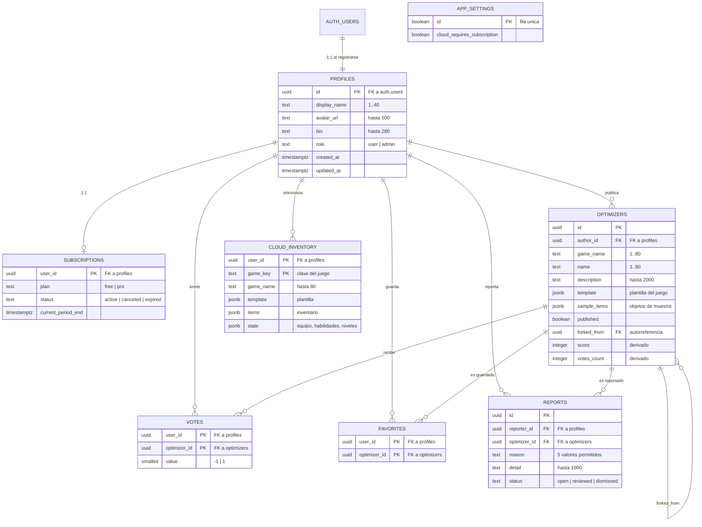

# Modelo de datos

Zenith Optimizer guarda en dos lugares distintos, y la separación es una decisión de
arquitectura, no un detalle de implementación:

| Almacenamiento | Qué guarda | Por qué |
|---|---|---|
| **IndexedDB** (Dexie, en el dispositivo) | inventario completo, equipo, habilidades, historial de niveles | el inventario puede tener miles de piezas y no tiene por qué salir del dispositivo |
| **PostgreSQL sobre Supabase** (compartido) | perfiles, optimizadores publicados, votos, favoritos, reportes, copia en la nube | es lo que necesita existir entre usuarios y sobrevivir al cambio de equipo |

El motor de cálculo no aparece en este documento: no accede a ninguna de las dos. Recibe un
contrato validado y devuelve un resultado.

## Modelo relacional

Nueve relaciones, ocho tablas de dominio más `auth.users`, que administra Supabase.

## Decisiones que se ven en el diagrama

**`profiles` cuelga de `auth.users`, no al revés.** Supabase es dueño de la autenticación; el
perfil es un dato de la aplicación. Con `on delete cascade`, borrar la cuenta borra el perfil,
su suscripción y todo lo que dependa de él. Un trigger `on_auth_user_created` crea el perfil y
la suscripción en el mismo instante del registro, para que no exista un usuario sin perfil.

**Las claves primarias compuestas evitan duplicados de negocio.** `votes (user_id,
optimizer_id)` hace imposible que alguien vote dos veces lo mismo, y `favorites (user_id,
optimizer_id)` lo mismo con los favoritos. No se resuelve con una validación en el cliente:
se resuelve donde no se puede esquivar.

**`cloud_inventory` usa `(user_id, game_key)`.** Un usuario tiene un paquete y un estado por
juego, no uno solo global. Esa es la diferencia entre "guardar mi inventario" y "guardar mis
juegos".

**`optimizers.forked_from` es una autorreferencia.** Crear una variante de un optimizador
ajeno no copia: enlaza. Así se puede reconstruir el linaje y saber qué se cambió.

## Normalización

El esquema está en **tercera forma normal**, con dos excepciones deliberadas y documentadas.

**1FN — valores atómicos.** Todas las columnas escalares son atómicas; los `text` tienen
restricciones de longitud explícitas (`char_length`) en lugar de confiar en el cliente.

Las tres columnas `jsonb` (`template`, `sample_items`, `items`/`state` de `cloud_inventory`)
son la excepción consciente: representan el **contrato del juego**, que el motor consume tal
cual. Normalizar la plantilla obligaría a una tabla por cada concepto del juego —atributos,
ranuras, conjuntos, derivadas, objetivos— y a reconstruirla en cada lectura para alimentar al
motor. Se guardan como documento, se validan con Zod (`GameTemplateSchema`) antes de escribir
y llevan tope de tamaño en la propia base (`octet_length <= 5 MB`). Los datos que sí se
consultan por columna —autor, nombre, estado, puntaje— están en columnas reales.

**2FN — sin dependencias parciales.** Ninguna tabla con clave compuesta tiene atributos que
dependan solo de una parte de la clave. En `votes (user_id, optimizer_id)`, el valor del voto
depende de la pareja completa, no de uno de los dos.

**3FN — sin dependencias transitivas.** Ningún atributo no clave depende de otro atributo no
clave. El nombre del autor no se repite en `optimizers`: se obtiene por `author_id`.

**Las dos excepciones, declaradas:**

| Columna | Depende de | Por qué se acepta |
|---|---|---|
| `optimizers.score` | `votes.value` | el ranking se ordena y se pagina por esta columna en cada consulta |
| `optimizers.votes_count` | cantidad de filas en `votes` | se muestra en cada tarjeta del catálogo |

Ambas son **desnormalización por rendimiento**: sin ellas, cada listado del catálogo exigiría
un `join` con agregación sobre `votes`. Se mantienen consistentes con un trigger
(`refresh_optimizer_score`) que recalcula ambos valores en cada `insert`, `update` o `delete`
de `votes`, y hay un índice `(published, score desc, created_at desc)` que sirve exactamente a
esa consulta. Nadie puede escribir esas columnas a mano.

## Reglas de integridad

Las restricciones viven en la base, no en el cliente:

| Regla | Dónde |
|---|---|
| un voto por usuario y optimizador | clave primaria compuesta |
| valor del voto en `-1` o `1` | `check (value in (-1, 1))` |
| un reporte por usuario y optimizador | `unique (reporter_id, optimizer_id)` |
| roles válidos | `check (role in ('user', 'admin'))` |
| longitud de textos del perfil | `check (char_length(...) between ...)` |
| tamaño del paquete | `check (octet_length(template::text) <= 5000000)` |
| `updated_at` siempre al día | trigger `set_updated_at` en cada tabla |

## Seguridad

Las ocho tablas tienen **Row Level Security activada** y se revocaron los permisos por
defecto: sobre cada tabla se concede solo lo necesario, y por columna donde importa (un
usuario puede actualizar `display_name`, `avatar_url` y `bio`, pero no su `role`).

| Tabla | Lectura | Escritura |
|---|---|---|
| `profiles` | pública | solo el propio, y sin tocar `role` |
| `optimizers` | publicados o propios | solo el autor |
| `votes` | pública | solo el emisor |
| `favorites` | solo el dueño | solo el dueño |
| `reports` | solo el emisor | solo el emisor |
| `cloud_inventory` | solo el dueño | solo el dueño, y solo con suscripción activa |
| `subscriptions` | solo el dueño | nadie desde el cliente; escribe el servidor |
| `app_settings` | pública | nadie desde el cliente |

La verificación no es una promesa: `npx nx test supabase` ejecuta 68 casos contra PGlite que
crean usuarios con distintos roles e intentan leer y escribir lo que no les corresponde. Una
política mal escrita rompe la prueba.

## Cómo se aplica

El esquema no se edita en el dashboard: vive en `supabase/migrations/` y se aplica con
`supabase db push`. Los tipos de TypeScript se generan desde la base
(`libs/shared-types/src/lib/database.types.ts`), así que un cambio de columna rompe la
compilación en lugar de fallar en producción.

Ver `supabase/README.md` para el procedimiento y `docs/entornos.md` para los tres ambientes.
