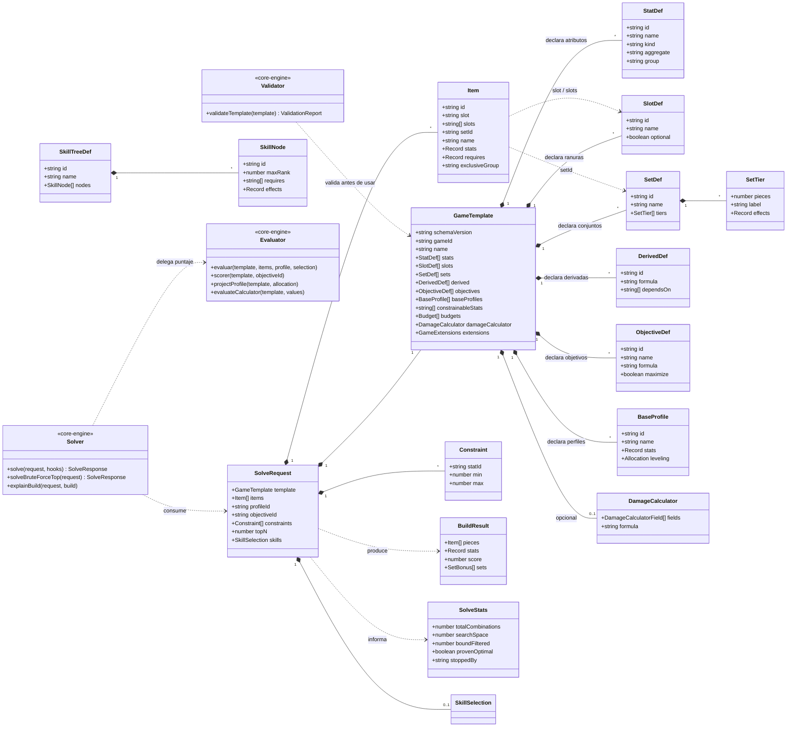
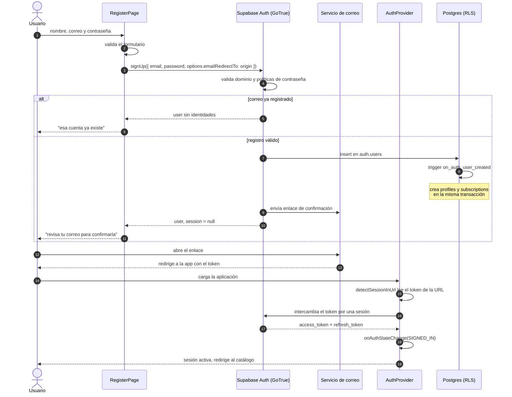
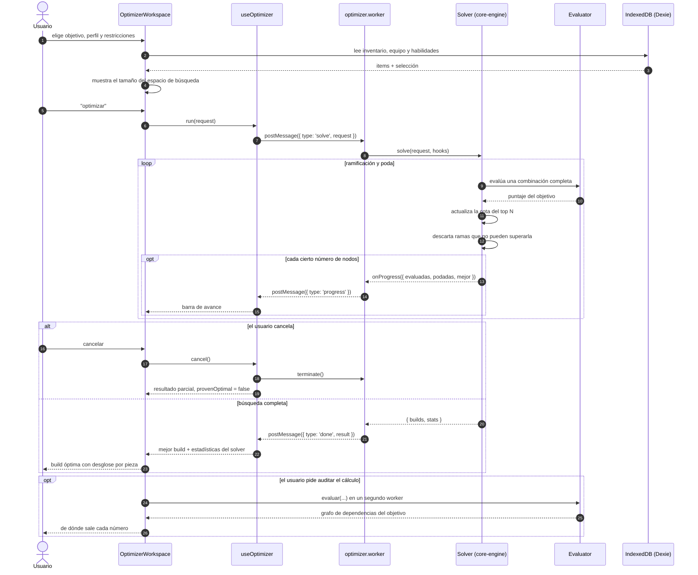

# Diagramas UML

Dos vistas del sistema: el **contrato** que hace que el motor sirva para cualquier juego, y
las **dos funcionalidades principales** en el tiempo —el alta de usuario y el cálculo de la
mejor build—.

Los diagramas se escriben en Mermaid para que vivan versionados junto al código y se
actualicen con un pull request. Ninguno se dibuja a mano en una herramienta externa, donde
quedaría desactualizado en la siguiente iteración.

## Diagrama de clases: el contrato del juego

`GameTemplate` es el único dato específico de un juego. El motor no conoce Genshin, WoW ni
Elden Ring: conoce esta estructura. Todo lo demás —interface, listado de atributos, orden de
cálculo, objetivos— se deriva de ella.

**Por qué esta forma.** `Item` no conoce `GameTemplate`: solo declara ranura, conjunto y
estadísticas por clave. Esa indirección es la que permite que el mismo binario del motor
resuelva cuatro juegos distintos sin una línea de código condicional por juego. Cuando una
pieza necesita algo propio del género, va en `extensions`, que el core **no interpreta**.

`SolveRequest` es serializable: viaja por `postMessage` a un Web Worker sin transformación,
así que el motor nunca bloquea la interfaz.

## Secuencia 1: registro de usuario con confirmación por correo

**Lo que este diagrama demuestra:** el perfil no lo crea el cliente. Lo crea un trigger cuando
nace el usuario en `auth.users`, así que no existe una ventana en la que haya una cuenta sin
perfil. Y el `redirect_to` que viaja en el registro es el origen real desde donde se registró
—producción, preview o local—, que es lo que hace que el enlace funcione en los tres entornos.

**El modo de falla conocido** está en `supabase/README.md`: el SMTP integrado de Supabase
limita los envíos por hora y devuelve `429 over_email_send_rate_limit`. Con confirmación
activada, el usuario queda sin poder entrar hasta que el correo llegue. Para una demo hace
falta un SMTP propio.

## Secuencia 2: cálculo de la mejor build

**Lo que este diagrama demuestra:** el cálculo ocurre en el navegador, en un Web Worker, y la
interfaz nunca se bloquea. El motor informa progreso *y* cota, así que el usuario ve crecer la
exploración y el podado en vivo: cuando el resultado dice "es la mejor combinación posible",
no es una expresión de confianza, es que `provenOptimal` salió de haber agotado el espacio. Y
cuando el usuario cancela, el resultado parcial se marca como tal en lugar de presentarse como
óptimo.

La evaluación del perfil y del daño usa un segundo worker separado del solver, para que
auditar un número no interrumpa una búsqueda en curso.
